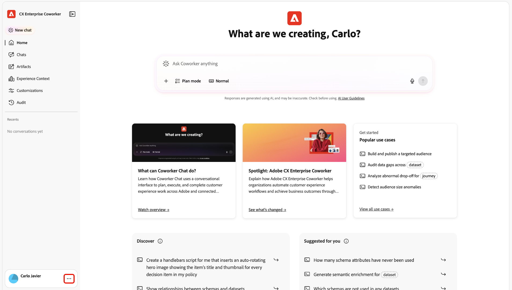
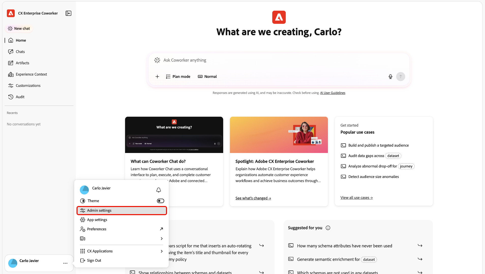
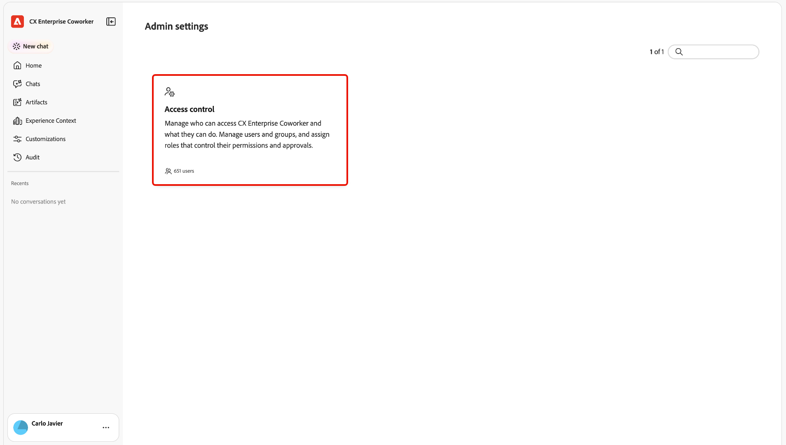

# Controllo degli accessi per il collaboratore {#access-control}

Utilizza il controllo degli accessi di Adobe CX Enterprise Coworker per gestire chi può utilizzare Coworker e quali funzionalità può utilizzare.

Il controllo degli accessi si applica al collega sia nella barra a destra che nell’esperienza a schermo intero.

>[!NOTE]
>
>Il controllo degli accessi viene implementato progressivamente per tutti i clienti con accesso Coworker. È possibile che [!UICONTROL Il controllo di accesso] non sia ancora presente nell&#39;organizzazione. Per ulteriori informazioni, vedere [Informazioni sull&#39;accesso](#get-help-with-access).

## Come viene determinato l’accesso {#how-access-is-determined}

In qualità di amministratore di Coworker, utilizza [!UICONTROL Imposta accesso predefinito] per attivare o disattivare l&#39;accesso di Coworker per l&#39;intera organizzazione. Puoi anche configurare le sostituzioni di accesso per utenti o gruppi di utenti specifici. Per impostazione predefinita, l’accesso all’organizzazione potrebbe essere abilitato o disabilitato.

| Impostazione | Effetti sull’accesso |
| --- | --- |
| Impostazione a livello di organizzazione | Abilita l’accesso Collaboratore per tutti o disabilitalo per la tua organizzazione. |
| Sostituzione utente o gruppo di utenti | Le sostituzioni consentono agli amministratori di controllare l’accesso di Collaboratore per utenti o gruppi di utenti specifici. |
| Autorizzazioni di applicazioni compatibili | I controlli di accesso al collaboratore determinano se è possibile accedere alle funzionalità di Collaboratore generalmente disponibili. Coworker eredita le autorizzazioni utente dalle applicazioni CX Enterprise compatibili con Coworker e rispetta le autorizzazioni già applicate da ciascuna applicazione. |

## Amministratori collaboratori {#add-coworker-admins}

Un amministratore di Coworker è un utente assegnato come **[!UICONTROL Amministratore di sistema]** per l&#39;organizzazione o come **[!UICONTROL Amministratore di prodotto]** di [!DNL Adobe Experience Platform] in [!DNL Adobe Admin Console].

## Gestire l’accesso degli utenti {#manage-user-access}

Utilizza [!UICONTROL Controllo dell&#39;accesso] in Coworker per gestire l&#39;accesso di singoli utenti o gruppi di utenti.

>[!NOTE]
>
>Seleziona fino a 100 utenti o gruppi di utenti per azione in blocco. Quando esportate gli utenti, l&#39;esportazione include solo gli utenti caricati.

1. Apri l’esperienza Collaboratore. Per istruzioni, consulta [Accedi a Coworker](/help/chat/ui-guide.md#sign-in).
1. Apri il menu del profilo e seleziona **[!UICONTROL Impostazioni amministratore]**.

   

   

1. Selezionare **[!UICONTROL Controllo dell&#39;accesso]**.

   

   Usa questo video per scoprire come gestire gli utenti di Collaborator.

   >[!VIDEO](https://video.tv.adobe.com/v/3507151?learn=on){transcript=true}

1. In **[!UICONTROL Imposta accesso predefinito]**, attiva o disattiva l&#39;accesso per la tua organizzazione:

   * **Attivato:** abilita l&#39;accesso a Collaboratore per tutti gli utenti dell&#39;organizzazione, in base alle sostituzioni di utenti o gruppi.
   * **Disattivato:** disabilita l&#39;accesso a Collaboratore per tutti gli utenti dell&#39;organizzazione, a meno che non consenti sostituzioni di utenti o gruppi.

   Per concedere l&#39;accesso a utenti o gruppi specifici mentre l&#39;accesso all&#39;organizzazione è disattivato, attivare **[!UICONTROL Consenti sostituzioni]**. Seleziona **[!UICONTROL Aggiungi sostituzione]** per aggiungere gli utenti o i gruppi che devono avere accesso.

1. Seleziona **[!UICONTROL Utenti]** per gestire l&#39;accesso individuale o **[!UICONTROL Gruppi di utenti]** per gestire l&#39;accesso al gruppo. Un&#39;impostazione del gruppo di utenti si applica ai relativi membri.

   I gruppi di utenti del collaboratore sono distinti da [!DNL Adobe Admin Console] gruppi. La sincronizzazione dei gruppi di utenti da [!DNL Adobe Admin Console] a Collaborator sarà presto disponibile.

   L’elenco Utenti include gli utenti dell’organizzazione. Il loro accesso dipende dall’impostazione predefinita della tua organizzazione e da eventuali sostituzioni di utenti o gruppi.

   * **Abilitato:** l&#39;utente o il gruppo di utenti è attivo.
   * **Disabilitato:** l&#39;utente o il gruppo di utenti è inattivo.

## Autorizzazioni nelle applicazioni CX Enterprise compatibili con Coworker {#permissions-in-compatible-applications}

Le applicazioni CX Enterprise compatibili con Coworker continuano a imporre le proprie autorizzazioni.

Il collaboratore rispetta le autorizzazioni nelle applicazioni compatibili. Ad esempio, se non è possibile accedere a un set di dati in [!DNL Adobe Experience Platform], non è possibile recuperare o agire automaticamente su tale set di dati.

## Ottieni aiuto per l’accesso {#get-help-with-access}

Se non trovi [!UICONTROL Controllo degli accessi], contatta l&#39;amministratore Adobe o il rappresentante Adobe. Può verificare se la funzione è abilitata per la tua organizzazione e se hai accesso alle sue impostazioni.

Se ti viene negato l’accesso, chiedi all’amministratore di rivedere le impostazioni predefinite a livello di organizzazione ed eventuali impostazioni per utenti o gruppi. Per un’applicazione CX Enterprise compatibile con Coworker, chiedi loro di controllare le autorizzazioni gestite separatamente per tale applicazione.

## Ulteriori informazioni su questo argomento {#more-help}

Utilizzare queste risorse per ulteriori informazioni su Collaboratore e amministrazione.

* [Panoramica sulla chat del collaboratore](/help/chat/overview.md)
* [Introduzione alla chat con i collaboratori](/help/chat/ui-guide.md)
* [Gestire plug-in e marketplace](/help/customizations/plugins/manage-plugins-for-your-org.md)
