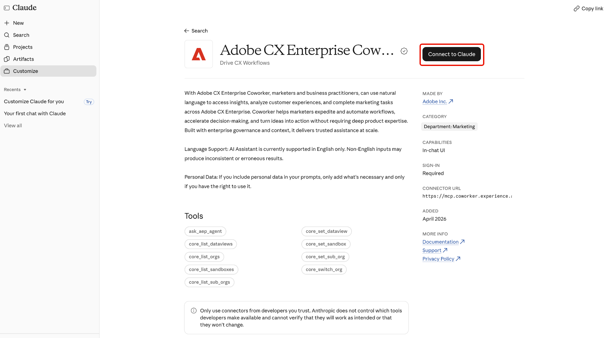

# Adobe CX Enterprise Coworker per piattaforme AI

Utilizza Adobe CX Enterprise Coworker for AI Platforms per ottenere informazioni di marketing negli strumenti di intelligenza artificiale già in uso. Poni domande in linguaggio naturale senza cambiare strumento. Trova il prodotto elencato come Adobe CX Enterprise Coworker in ogni piattaforma.

Trova le piattaforme disponibili e le relative istruzioni di installazione in [Configura Coworker](#set-up-coworker).

Non ci sono costi aggiuntivi per utilizzare Coworker nelle piattaforme AI. È incluso nella licenza CX Enterprise Coworker e l’utilizzo deriva dagli stessi crediti IA di altre funzioni di Coworker. Per ulteriori informazioni, consulta [Processi agente Adobe Experience Platform e consumo di crediti AI](https://experienceleague.adobe.com/it/docs/cx-enterprise-ai/experience-cloud-ai/overview/ai-credit-consumption){target="_blank"}.

<!-- TODO: architecture diagram pending from engineering. KT page notes "to be provided on 8/28"; still outstanding as of 8/31. Insert here once received. -->

## Prerequisiti {#prerequisites}

Prima di poter utilizzare Coworker in una piattaforma di intelligenza artificiale, verifica di disporre dei seguenti elementi.

* È stato eseguito il provisioning di Adobe CX Enterprise Coworker per la tua organizzazione e il tuo accesso in Adobe.
* Adobe Experience Platform e almeno uno di Adobe Real-Time CDP, Adobe Journey Optimizer o Adobe Customer Journey Analytics.
* Accesso a una piattaforma di intelligenza artificiale elencata in [Configura Coworker](#set-up-coworker).

## Accesso ai dati e autorizzazioni {#data-access-and-permissions}

Il collaboratore nelle piattaforme AI riflette gli stessi dati e il medesimo livello di accesso associati alla tua identità Adobe. Ciò a cui puoi fare query e vedere corrisponde a ciò a cui hai già diritto in Experience Platform e nelle relative soluzioni. Coworker eredita tali autorizzazioni, pertanto non è necessaria alcuna configurazione di autorizzazioni separata per l’integrazione della piattaforma di intelligenza artificiale. Coworker restituisce informazioni di sola lettura e non modifica i dati dei clienti. Rivedi eventuali riepiloghi e analisi generati prima di utilizzarli per prendere decisioni commerciali.

<!-- Confirmed by PM (Siddhartha Srivastava) on 2026-09-02 for Microsoft 365 Copilot, Claude, and ChatGPT. Validate this permissions model for each additional platform before adding its setup section. -->

## Casi d’uso principali {#key-use-cases}

Utilizza Coworker nelle piattaforme AI per velocizzare i flussi di lavoro di marketing comuni senza uscire dagli strumenti di uso quotidiano.

| Caso d’uso | Descrizione |
| --- | --- |
| Pianificare e rivedere le campagne | Pianifica le campagne, incluse le revisioni delle campagne dei partner e le previsioni del pubblico. Confronta le prestazioni della campagna nel tempo e identifica quali punti di contatto generano le conversioni. |
| Monitorare i percorsi e la preparazione alla campagna | Rivedi e monitora le campagne attive, analizza i percorsi dei clienti e valuta la fattibilità delle campagne. Monitora le prestazioni del percorso e i rilasci per individuare le opportunità di ottimizzazione. |
| Recuperare informazioni operative | Identifica i tipi di pubblico più grandi o più coinvolti, in modo da poter definire i punti prioritari su cui concentrare le attività e monitorare come i segmenti aumentano o si riducono nel tempo. |
| Ottimizzare flussi di lavoro e contenuti | Ottimizza i flussi di lavoro e identifica le esigenze di risorse e contenuti per le campagne CX. Genera report visivi sulle prestazioni della campagna senza creare manualmente query o dashboard. |
| Collaborazione e decisioni più rapide | Utilizza i prompt suggeriti per esplorare tipi di pubblico, campagne e traffico web. Condividi informazioni con il tuo team durante le riunioni di pianificazione e rispondi a domande specifiche in tempo reale durante la revisione di piani o deck. |

<!-- Use cases approved by PM Siddhartha Srivastava on 2026-08-31 and confirmed for Microsoft 365 Copilot, Claude, and ChatGPT on 2026-09-02. Validate applicability for each additional platform before adding its setup section. -->

## Configurare il collaboratore {#set-up-coworker}

Selezionare una piattaforma disponibile per le istruzioni di configurazione. Dopo l&#39;installazione, provare le [richieste di esempio](#example-prompts).

* [Copilota Microsoft 365](#microsoft-365-copilot)
* [ChatGPT](#chatgpt)
* [Claude](#claude)
* [Gemini Enterprise](#gemini-enterprise)
* [Amazon Quick](#amazon-quick)
* [IBM watsonx Orchestrate](#ibm-watsonx-orchestrate)
* [Databricks](#databricks)

### [!DNL Microsoft 365 Copilot] {#microsoft-365-copilot}

Utilizza [!DNL Adobe CX Enterprise Coworker for Copilot] per ottenere informazioni di marketing in [!DNL Microsoft 365 Copilot].

Prima di iniziare, verificare di avere accesso a [!DNL Microsoft 365 Copilot].

#### Impostare l’accesso all’organizzazione {#copilot-organization-setup}

Un amministratore deve completare questi passaggi prima che gli utenti finali possano accedere a Collaborator in [!DNL Microsoft 365 Copilot].

1. In [!DNL Microsoft 365 admin center], confermare che le impostazioni del tenant consentono le app e gli agenti generati da editori esterni.
1. Approva **[!UICONTROL Adobe CX Enterprise Coworker]** sia in [!DNL Microsoft 365 admin center] che in [!DNL Teams admin center]. In genere è possibile trovare l&#39;agente tramite [!DNL Microsoft Commercial Marketplace] o l&#39;elenco delle **[!UICONTROL app integrate]** dell&#39;organizzazione.
1. Distribuire l&#39;agente agli utenti finali. Puoi distribuirlo a specifici utenti o gruppi oppure all’intera organizzazione. Il numero di utenti abilitati non influisce sulla configurazione o sui costi.

>[!NOTE]
>
>Se [!DNL Microsoft] rilascia un aggiornamento a Coworker che richiede nuove autorizzazioni, l&#39;amministratore deve approvare l&#39;aggiornamento in [!DNL Agent Registry] prima che venga eseguito per gli utenti.

#### Accedi a Collaboratore {#copilot-access}

Una volta che l&#39;amministratore abilita Coworker, potrai accedervi tra [!DNL Microsoft 365 Copilot] superfici, tra cui [!DNL Teams], [!DNL Word], [!DNL Excel], [!DNL PowerPoint] e chat Web.

In [!DNL Microsoft 365 Copilot], selezionare **[!UICONTROL Agenti]**, quindi **[!UICONTROL Altri agenti]**.

Selezionare **[!UICONTROL Adobe CX Enterprise Coworker]** nel catalogo agenti.

Infine, seleziona **[!UICONTROL Aggiungi]** per aggiungere Coworker ai tuoi agenti.

### [!DNL ChatGPT] {#chatgpt}

Utilizza [!DNL Adobe CX Enterprise Coworker for ChatGPT] per ottenere informazioni di marketing in [!DNL ChatGPT].

Prima di iniziare, verificare di avere accesso a [!DNL ChatGPT].

#### Impostare l’accesso all’organizzazione {#chatgpt-organization-setup}

L&#39;amministratore deve approvare Collaboratore prima di aggiungerlo.

* Chiedi all&#39;amministratore di [!DNL ChatGPT] di approvare **[!UICONTROL Adobe CX Enterprise Coworker]** per gli utenti selezionati o per l&#39;intera organizzazione.

#### Accedi a Collaboratore {#chatgpt-access}

In [!DNL ChatGPT], selezionare **[!UICONTROL Plugin]**.

Individua e seleziona **[!UICONTROL Adobe CX Enterprise Coworker]** nel catalogo dei plug-in.

Infine, selezionare **[!UICONTROL Installa plug-in]** per aggiungere Coworker a [!DNL ChatGPT].

### [!DNL Claude] {#claude}

Utilizzare Coworker per ottenere informazioni di marketing in [!DNL Claude].

Prima di iniziare, verificare di avere accesso a [!DNL Claude].

#### Impostare l’accesso all’organizzazione {#claude-organization-setup}

L&#39;amministratore deve approvare Collaboratore prima di aggiungerlo.

* Chiedi all&#39;amministratore di [!DNL Claude] di approvare **[!UICONTROL Adobe CX Enterprise Coworker]** per gli utenti selezionati o per l&#39;intera organizzazione.

#### Accedi a Collaboratore {#claude-access}

1. In [!DNL Claude], selezionare **[!UICONTROL Personalizza]**.

   

1. Seleziona **[!UICONTROL Connettori]**, quindi **[!UICONTROL Individua]** e utilizza **[!UICONTROL Cerca]** per trovare Adobe CX Enterprise Coworker.

   

1. Seleziona **[!UICONTROL Adobe CX Enterprise Coworker]**, quindi seleziona **[!UICONTROL Connetti a Claude]**.

   

1. Accedi con le credenziali Adobe per connettere Collaborator a [!DNL Claude].

### [!DNL Gemini Enterprise] {#gemini-enterprise}

Utilizzare Coworker per ottenere informazioni di marketing in [!DNL Gemini Enterprise].

Prima di iniziare, verificare di avere accesso a [!DNL Gemini Enterprise].

#### Impostare l’accesso all’organizzazione {#gemini-organization-setup}

In qualità di amministratore [!DNL Gemini Enterprise], completa questi passaggi per rendere Customer Workfront disponibile per la tua organizzazione.

1. Vai al [marketplace Gemini Enterprise AI Agents](https://console.cloud.google.com/marketplace/browse?filter=solution-type:ai-agent-service).
1. Cerca Adobe CX Enterprise Coworker, quindi seleziona la scheda agente **[!UICONTROL Adobe CX Enterprise Coworker]**.
1. Sulla scheda dell&#39;agente, selezionare **[!UICONTROL Contatta vendite]**.

   {width="700"}

1. Completa il modulo per inviare la richiesta ad Adobe.

   {width="600"}

   Adobe crea un’offerta privata gratuitamente e ti invia un collegamento via e-mail.

1. Apri il collegamento e-mail e approva l’offerta privata.

   Dopo l&#39;approvazione dell&#39;offerta, Adobe abilita l&#39;agente per l&#39;account [!DNL Gemini Enterprise].

1. Pubblica l’agente per gli utenti selezionati o per tutti gli utenti aziendali dell’organizzazione.

#### Accedi a Collaboratore {#gemini-access}

Dopo che l&#39;amministratore ti ha pubblicato Collaborator, aprilo in [!DNL Gemini Enterprise] per iniziare a porre domande.

1. In [!DNL Gemini Enterprise], passare al catalogo **[!UICONTROL Agenti]**.
1. Cerca Adobe CX Enterprise Coworker.
1. Seleziona **[!UICONTROL Adobe CX Enterprise Coworker]** e immetti un prompt per iniziare.

Per idee, esplora i [casi d&#39;uso chiave](#key-use-cases) e [prompt di esempio](#example-prompts).

### [!DNL Amazon Quick] {#amazon-quick}

Utilizzare Coworker per ottenere informazioni di marketing in [!DNL Amazon Quick].

Prima di iniziare, verifica di avere accesso a [!DNL Amazon Quick] e al tuo account Adobe.

#### Connetti collega {#amazon-quick-connection}

Connetti il collaboratore in [!DNL Amazon Quick] tramite Model Context Protocol (MCP). Adobe ha già approvato [!DNL Amazon Quick] per questa connessione.

1. In [!DNL Amazon Quick], passa a **[!UICONTROL Connettori]**.
1. Cercare MCP e aprire la configurazione del connettore.
1. Immettere `https://mcp.coworker.experience.adobe.io` come URL del server MCP.

   Attendere alcuni minuti per il completamento e la registrazione della connessione.

1. Segui le istruzioni di configurazione e accedi con le tue credenziali Adobe.
1. Prima di iniziare a porre domande, verifica che la connessione abbia esito positivo.

#### Accedi a Collaboratore {#amazon-quick-access}

Dopo aver connesso Collaboratore, utilizzalo in [!DNL Amazon Quick] per porre domande sui tuoi dati Adobe.

Per idee, esplora i [casi d&#39;uso chiave](#key-use-cases) e [prompt di esempio](#example-prompts).

### [!DNL IBM watsonx Orchestrate] {#ibm-watsonx-orchestrate}

Utilizzare Coworker per ottenere informazioni di marketing in [!DNL IBM watsonx Orchestrate].

Prima di iniziare, verifica di avere accesso a [!DNL IBM watsonx Orchestrate] e al tuo account Adobe.

È inoltre necessario disporre delle autorizzazioni necessarie per gestire le connessioni, registrare i server MCP e modificare un agente. Prima della configurazione, conferma le impostazioni client OAuth con il tuo rappresentante Adobe.

#### Creare la connessione di Collaboratore {#ibm-connection}

Connetti Collaboratore utilizzando OAuth, quindi esegui l’autenticazione con il tuo account Adobe. I passaggi seguenti preparano la connessione per il test nell’ambiente di bozza.

1. In [!DNL IBM watsonx Orchestrate], vai a **[!UICONTROL Connessioni]**, quindi seleziona **[!UICONTROL Aggiungi connessione]**.
1. Immetti un **[!UICONTROL ID connessione]**, **[!UICONTROL Nome visualizzato]** e una **[!UICONTROL Descrizione connessione]** facoltativa, quindi seleziona **[!UICONTROL Salva e continua]**.
1. In **[!UICONTROL Configura ambiente bozza]**, selezionare **[!UICONTROL Codice autorizzazione OAuth2]** come **[!UICONTROL Tipo autenticazione]**.
1. Immetti le impostazioni di connessione.

   | Campo | Valore |
   | --- | --- |
   | [!UICONTROL URL server] | `https://mcp.coworker.experience.adobe.io` |
   | [!UICONTROL URL token] | Endpoint token confermato per il client OAuth. |
   | [!UICONTROL URL autorizzazione] | Endpoint di autorizzazione confermato per il client OAuth. |
   | [!UICONTROL ID client] | L&#39;ID client OAuth approvato. |
   | [!UICONTROL Segreto client] | Il segreto client OAuth approvato. |

   {width="700"}

1. Seleziona **[!UICONTROL PKCE]** e **[!UICONTROL Credenziali membro]**, quindi seleziona **[!UICONTROL Successivo]**.
1. Completa **[!UICONTROL Configura ambiente live]**, quindi seleziona **[!UICONTROL Fine]** per salvare la connessione.

<!-- Confirm the customer process for obtaining OAuth settings before publication. -->

#### Accedi con Adobe {#ibm-sign-in}

Aggiungi le credenziali membro per autenticare la connessione con la tua identità Adobe.

1. Vai a **[!UICONTROL Impostazioni]** > **[!UICONTROL Credenziali membro]**, quindi seleziona **[!UICONTROL Aggiungi credenziali membro]**.
1. Selezionare la connessione a Coworker e passare a **[!UICONTROL Imposta credenziali]**.
1. Seleziona **[!UICONTROL Connetti e salva]**, quindi accedi con le credenziali Adobe quando richiesto.
1. Torna a [!DNL IBM watsonx Orchestrate] e verifica che le credenziali siano state aggiunte correttamente.

#### Registra il server MCP {#ibm-register-server}

Registra il collaboratore tramite Model Context Protocol (MCP) per importare i relativi strumenti in [!DNL IBM watsonx Orchestrate].

1. Vai a **[!UICONTROL GATEWAY AI]** > **[!UICONTROL Server MCP]**, quindi seleziona **[!UICONTROL Registra server]**.
1. Immettere le impostazioni del server.

   | Campo | Valore |
   | --- | --- |
   | [!UICONTROL Nome server] | Un nome descrittivo, ad esempio `cx-coworker`. |
   | [!UICONTROL Tipo di trasporto] | [!UICONTROL HTTP semplificabile] |
   | [!UICONTROL URL server MCP] | `https://mcp.coworker.experience.adobe.io` |
   | [!UICONTROL Connessione] | La connessione a Collaboratore autenticata. |

1. Seleziona **[!UICONTROL Registra]** e attendi il completamento della registrazione del server e dell&#39;importazione dello strumento.

   {width="700"}

#### Aggiungi strumenti al tuo agente {#ibm-agent-tools}

Aggiungi gli strumenti importati all&#39;agente, quindi verifica la connessione prima di distribuire l&#39;agente.

1. Vai a **[!UICONTROL Inventario attivo]** > **[!UICONTROL Agenti]** e apri l&#39;agente che desideri configurare.
1. In **[!UICONTROL Build]**, selezionare **[!UICONTROL Strumenti]**, quindi **[!UICONTROL Aggiungi strumento]**.
1. Seleziona **[!UICONTROL Server MCP]** e individua gli strumenti dal tuo server Collaboratore registrato.
1. Seleziona gli strumenti di collaborazione necessari, quindi seleziona **[!UICONTROL Aggiungi all&#39;agente]**.
1. Immetti un prompt in **[!UICONTROL Anteprima bozza]** e controlla la risposta per confermare che la connessione funziona.

Per idee, esplora i [casi d&#39;uso chiave](#key-use-cases) e [prompt di esempio](#example-prompts).

### [!DNL Databricks] {#databricks}

Utilizzare Coworker per ottenere informazioni di marketing in [!DNL Databricks Genie One].

Prima di iniziare, verifica di avere accesso a [!DNL Databricks Genie One] e al tuo account Adobe. È inoltre necessaria l&#39;autorizzazione per installare un servizio MCP nel catalogo e nello schema [!DNL Unity Catalog] scelto.

Prima della configurazione, conferma le impostazioni client OAuth con il tuo rappresentante Adobe.

#### Installa Collaboratore {#databricks-install}

Installare il servizio MCP di Collaboratore da [!DNL Databricks Marketplace].

1. In [!DNL Databricks], vai a **[!UICONTROL Marketplace]** e cerca Adobe Coworker.
1. Seleziona **[!UICONTROL Adobe CX Enterprise Coworker]**, quindi seleziona **[!UICONTROL Installa]**.
1. Seleziona un **[!UICONTROL catalogo]** e uno **[!UICONTROL schema]**, quindi immetti un **[!UICONTROL nome servizio MCP]**.
1. Mantenere le impostazioni di connessione fornite dall&#39;elenco, inclusi i seguenti valori.

   | Campo | Valore |
   | --- | --- |
   | [!UICONTROL Host] | `https://mcp.coworker.experience.adobe.io` |
   | [!UICONTROL Percorso base] | `/mcp` |
   | [!UICONTROL Tipo di credenziali] | [!UICONTROL OAuth U2M] |

   {width="700"}

1. Immetti **[!UICONTROL ID client]** e **[!UICONTROL Segreto client]**.
1. Rivedi e accetta i termini, quindi seleziona **[!UICONTROL Installa]**.

<!-- Confirm the customer process for obtaining OAuth settings before publication. -->

#### Connetti il tuo account Adobe {#databricks-adobe-connection}

Ogni utente effettua l’accesso con il proprio account Adobe. Le richieste di collaborazione utilizzano le autorizzazioni Adobe dello stesso utente.

1. In **[!UICONTROL Catalogo]**, apri il servizio Coworker installato nel catalogo e nello schema selezionati.
1. Quando richiesto, completa l’accesso ad Adobe.
1. Verificare che il servizio **[!UICONTROL Stato]** sia **[!UICONTROL Attivo]** e che i relativi strumenti siano elencati.
1. In **[!UICONTROL Inizia]**, seleziona **[!UICONTROL Genie]**, quindi **[!UICONTROL Genie One]**, quindi seleziona **[!UICONTROL Aggiungi a Genie One]**.

#### Accedi a Collaboratore {#databricks-access}

Verificare che il connettore sia disponibile prima di porre domande in [!DNL Genie One].

1. In [!DNL Genie One], vai a **[!UICONTROL Personalizzazioni]** > **[!UICONTROL Connettori]** e apri il connettore Coworker.
1. Verificare che nel connettore sia visualizzato **[!UICONTROL Connesso]**. Rivedi le impostazioni di approvazione dello strumento in base ai criteri della tua organizzazione.

   {width="700"}

1. Seleziona **[!UICONTROL Nuova chat]** e immetti un prompt, ad esempio &quot;Utilizzo di Adobe Coworker, elenca i tipi di pubblico pubblicati&quot;.

Per idee, esplora i [casi d&#39;uso chiave](#key-use-cases) e [prompt di esempio](#example-prompts).

<!-- Setup steps for Microsoft 365 Copilot, ChatGPT, and Claude reflect the real customer-facing flow confirmed by PM (Siddhartha Srivastava) on 2026-09-02: an org admin approves the connector or plugin, then end users find and add it in their platform's catalog and sign in. The previous version of this file described a manual MCP-connector setup for ChatGPT (Settings > Connectors > paste server URL) -- PM clarified that flow is for internal testing only, not the customer path, so it was removed here. -->

<!-- Amazon Quick setup follows PM guidance from the October 28, 2026 email, "Coworker in AI Platforms screenshots - Gemini / Amazon Quick." End users connect through MCP and sign in with Adobe credentials. -->

## Esempi di prompt {#example-prompts}

Dopo aver configurato Collaboratore in una piattaforma supportata, prova questi prompt o scrivi il tuo in un linguaggio naturale.

* Mostra i primi cinque tipi di pubblico.
* Mostra una metrica per l’ultimo mese.
* Mostra i progetti Workfront attivi.
* Mostra percorsi con tipi di pubblico fedeltà.

## Limitazioni note {#known-limitations}

Coworker nelle piattaforme AI non supporta tutte le funzionalità disponibili nell’interfaccia di Coworker.

* Non è possibile connettere Coworker a un cablaggio preassemblato agente personalizzato esterno alle piattaforme AI supportate elencate in questo documento. Per richiedere supporto per piattaforme AI o cablaggi preassemblati aggiuntivi tramite MCP, contatta il rappresentante Adobe.
* L’abilità Generazione immagine di Firefly non è disponibile quando accedi a Coworker tramite Claude. L’abilità rimane disponibile nell’interfaccia di Collaboratore e in altre piattaforme di intelligenza artificiale supportate descritte in questo documento. Per utilizzare l’abilità Generazione immagini di Firefly, accedi a Coworker tramite l’interfaccia di Coworker o un’altra piattaforma di intelligenza artificiale supportata.

## Risolvere i problemi relativi a Coworker nelle piattaforme AI {#troubleshoot}

Prova questi passaggi se riscontri problemi durante l’utilizzo di Coworker in una piattaforma di intelligenza artificiale.

* Se ricevi un errore, esci e accedi di nuovo con le tue credenziali Adobe. La riautenticazione risolve la maggior parte dei problemi.
* Se non riesci ad accedere a Cooker o a dati specifici, contatta l’amministratore Adobe per confermare l’accesso e le autorizzazioni del prodotto.

<!--
Editorial maintenance, 2026-10-27:
Only approved platforms with validated setup guidance belong in the platform sections.
Databricks setup follows the supplied "Adobe Coworker in Genie One.mp4" walkthrough. Confirm marketplace availability and customer OAuth provisioning before publication.

To add an approved platform:
* Confirm approval and obtain access to the customer flow.
* Validate prerequisites, organization approval, catalog discovery, listing name, installation, and Adobe sign-in.
* Confirm the shared licensing, permissions, use cases, prompts, limitations, and troubleshooting guidance applies.
* Add an H3 platform section with an explicit anchor under Set up Coworker and add it to the linked platform list.
* Follow the existing order: introduction, platform prerequisites, setup tasks, and user access. Use H4 task headings with unique anchors.
* Document any platform-specific requirements or exceptions within that section.
* Preview the section and verify its links and image references.
Keep the article introduction, metadata, and shared prerequisites free of platform lists so adding a section does not require duplicate updates.

Gemini Enterprise follow-up:
Administrator setup and end user access steps are documented. Confirm applicability of the shared guidance before expanding the section.
-->
