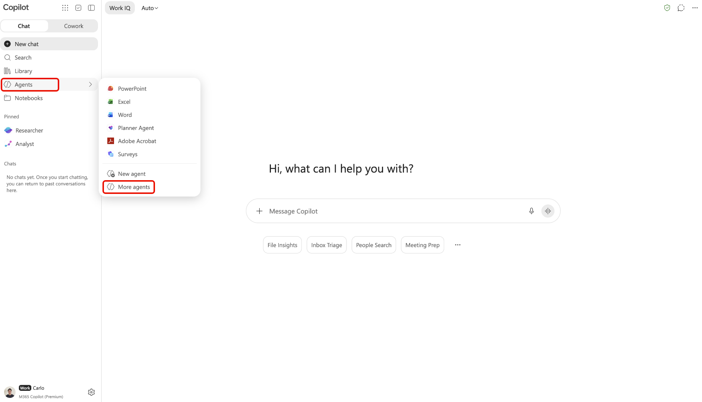

# Adobe CX Enterprise Coworker per piattaforme AI

Utilizza Adobe CX Enterprise Coworker for AI Platforms per ottenere informazioni di marketing negli strumenti di intelligenza artificiale già in uso. Poni domande in linguaggio naturale senza cambiare strumento. Trova il prodotto elencato come Adobe CX Enterprise Coworker in ogni piattaforma.

Trova le piattaforme disponibili e le relative istruzioni di installazione in [Configura Coworker](#set-up-coworker).

Non ci sono costi aggiuntivi per utilizzare Coworker nelle piattaforme AI. È incluso nella licenza CX Enterprise Coworker e l’utilizzo deriva dagli stessi crediti IA di altre funzioni di Coworker. Per ulteriori informazioni, consulta [Processi agente Adobe Experience Platform e consumo di crediti AI](https://experienceleague.adobe.com/it/docs/cx-enterprise-ai/experience-cloud-ai/overview/ai-credit-consumption){target="_blank"}.

<!-- TODO: architecture diagram pending from engineering. KT page notes "to be provided on 8/28"; still outstanding as of 8/31. Insert here once received. -->

## Prerequisiti {#prerequisites}

Prima di poter utilizzare Coworker in una piattaforma di intelligenza artificiale, verifica di disporre dei seguenti elementi.

* È stato eseguito il provisioning di Adobe CX Enterprise Coworker per la tua organizzazione e il tuo accesso in Adobe.
* Adobe Experience Platform e almeno uno di Adobe Real-Time CDP, Adobe Journey Optimizer o Adobe Customer Journey Analytics.
* Accesso a una piattaforma di intelligenza artificiale elencata in [Configura Coworker](#set-up-coworker).

## Accesso ai dati e autorizzazioni {#data-access-and-permissions}

Il collaboratore nelle piattaforme AI riflette gli stessi dati e il medesimo livello di accesso associati alla tua identità Adobe. Ciò a cui puoi fare query e vedere corrisponde a ciò a cui hai già diritto in Experience Platform e nelle relative soluzioni. Coworker eredita tali autorizzazioni, pertanto non è necessaria alcuna configurazione di autorizzazioni separata per l’integrazione della piattaforma di intelligenza artificiale. Coworker restituisce informazioni di sola lettura e non modifica i dati dei clienti. Rivedi eventuali riepiloghi e analisi generati prima di utilizzarli per prendere decisioni commerciali.

<!-- Confirmed by PM (Siddhartha Srivastava) on 2026-09-02 for Microsoft 365 Copilot, Claude, and ChatGPT. Validate this permissions model for each additional platform before adding its setup tab. -->

## Casi d’uso principali {#key-use-cases}

Utilizza Coworker nelle piattaforme AI per velocizzare i flussi di lavoro di marketing comuni senza uscire dagli strumenti di uso quotidiano.

| Caso d’uso | Descrizione |
| --- | --- |
| Pianificare e rivedere le campagne | Pianifica le campagne, incluse le revisioni delle campagne dei partner e le previsioni del pubblico. Confronta le prestazioni della campagna nel tempo e identifica quali punti di contatto generano le conversioni. |
| Monitorare i percorsi e la preparazione alla campagna | Rivedi e monitora le campagne attive, analizza i percorsi dei clienti e valuta la fattibilità delle campagne. Monitora le prestazioni del percorso e i rilasci per individuare le opportunità di ottimizzazione. |
| Recuperare informazioni operative | Identifica i tipi di pubblico più grandi o più coinvolti, in modo da poter definire i punti prioritari su cui concentrare le attività e monitorare come i segmenti aumentano o si riducono nel tempo. |
| Ottimizzare flussi di lavoro e contenuti | Ottimizza i flussi di lavoro e identifica le esigenze di risorse e contenuti per le campagne CX. Genera report visivi sulle prestazioni della campagna senza creare manualmente query o dashboard. |
| Collaborazione e decisioni più rapide | Utilizza i prompt suggeriti per esplorare tipi di pubblico, campagne e traffico web. Condividi informazioni con il tuo team durante le riunioni di pianificazione e rispondi a domande specifiche in tempo reale durante la revisione di piani o deck. |

<!-- Use cases approved by PM Siddhartha Srivastava on 2026-08-31 and confirmed for Microsoft 365 Copilot, Claude, and ChatGPT on 2026-09-02. Validate applicability for each additional platform before adding its setup tab. -->

## Configurare il collaboratore {#set-up-coworker}

Selezionare una piattaforma disponibile per le istruzioni di configurazione. Dopo l&#39;installazione, provare le [richieste di esempio](#example-prompts).

>[!BEGINTABS]

>[!TAB Copilota Microsoft 365]

Utilizza [!DNL Adobe CX Enterprise Coworker for Copilot] per ottenere informazioni di marketing in [!DNL Microsoft 365 Copilot].

Prima di iniziare, verificare di avere accesso a [!DNL Microsoft 365 Copilot].

**Configura il tuo collaboratore**

Un amministratore deve completare questi passaggi prima che gli utenti finali possano accedere a Collaborator in [!DNL Microsoft 365 Copilot].

1. In [!DNL Microsoft 365 admin center], confermare che le impostazioni del tenant consentono le app e gli agenti generati da editori esterni.
1. Approva **[!UICONTROL Adobe CX Enterprise Coworker]** sia in [!DNL Microsoft 365 admin center] che in [!DNL Teams admin center]. In genere è possibile trovare l&#39;agente tramite [!DNL Microsoft Commercial Marketplace] o l&#39;elenco delle **[!UICONTROL app integrate]** dell&#39;organizzazione.
1. Distribuire l&#39;agente agli utenti finali. Puoi distribuirlo a specifici utenti o gruppi oppure all’intera organizzazione. Il numero di utenti abilitati non influisce sulla configurazione o sui costi.

>[!NOTE]
>
>Se [!DNL Microsoft] rilascia un aggiornamento a Coworker che richiede nuove autorizzazioni, l&#39;amministratore deve approvare l&#39;aggiornamento in [!DNL Agent Registry] prima che venga eseguito per gli utenti.

**Accedi a Collaboratore in[!DNL Copilot]**

Una volta che l&#39;amministratore abilita Coworker, potrai accedervi tra [!DNL Microsoft 365 Copilot] superfici, tra cui [!DNL Teams], [!DNL Word], [!DNL Excel], [!DNL PowerPoint] e chat Web.

In [!DNL Microsoft 365 Copilot], selezionare **[!UICONTROL Agenti]**, quindi **[!UICONTROL Altri agenti]**.

Selezionare **[!UICONTROL Adobe CX Enterprise Coworker]** nel catalogo agenti.

Infine, seleziona **[!UICONTROL Aggiungi]** per aggiungere Coworker ai tuoi agenti.

>[!TAB ChatGPT]

Utilizza [!DNL Adobe CX Enterprise Coworker for ChatGPT] per ottenere informazioni di marketing in [!DNL ChatGPT].

Prima di iniziare, verificare di avere accesso a [!DNL ChatGPT].

**Configura il tuo collaboratore**

* Chiedi all&#39;amministratore di [!DNL ChatGPT] di approvare **[!UICONTROL Adobe CX Enterprise Coworker]** per gli utenti selezionati o per l&#39;intera organizzazione.

**Accedi a Collaboratore in[!DNL ChatGPT]**

In [!DNL ChatGPT], selezionare **[!UICONTROL Plugin]**.

Individua e seleziona **[!UICONTROL Adobe CX Enterprise Coworker]** nel catalogo dei plug-in.

Infine, selezionare **[!UICONTROL Installa plug-in]** per aggiungere Coworker a [!DNL ChatGPT].

>[!TAB Claude]

Utilizzare Coworker per ottenere informazioni di marketing in [!DNL Claude].

Prima di iniziare, verificare di avere accesso a [!DNL Claude].

**Configura il tuo collaboratore**

* Chiedi all&#39;amministratore di [!DNL Claude] di approvare **[!UICONTROL Adobe CX Enterprise Coworker]** per gli utenti selezionati o per l&#39;intera organizzazione.

**Accedi a Collaboratore in[!DNL Claude]**

1. In [!DNL Claude], selezionare **[!UICONTROL Personalizza]**.

   

1. Seleziona **[!UICONTROL Connettori]**, quindi **[!UICONTROL Individua]** e utilizza **[!UICONTROL Cerca]** per trovare Adobe CX Enterprise Coworker.

   

1. Seleziona **[!UICONTROL Adobe CX Enterprise Coworker]**, quindi seleziona **[!UICONTROL Connetti a Claude]**.

   

1. Accedi con le credenziali Adobe per connettere Collaborator a [!DNL Claude].

>[!ENDTABS]

<!-- Setup steps above reflect the real customer-facing flow confirmed by PM (Siddhartha Srivastava) on 2026-09-02: an org admin approves the connector or plugin, then end users find and add it in their platform's catalog and sign in. The previous version of this file described a manual MCP-connector setup for ChatGPT (Settings > Connectors > paste server URL) -- PM clarified that flow is for internal testing only, not the customer path, so it was removed here. -->

## Esempi di prompt {#example-prompts}

Dopo aver configurato Collaboratore in una piattaforma supportata, prova questi prompt o scrivi il tuo in un linguaggio naturale.

* Mostra i primi cinque tipi di pubblico.
* Mostra una metrica per l’ultimo mese.
* Mostra i progetti Workfront attivi.
* Mostra percorsi con tipi di pubblico fedeltà.

## Limitazioni note {#known-limitations}

Coworker nelle piattaforme AI non supporta tutti i modelli di integrazione.

* Non è possibile collegare Coworker al proprio cablaggio preassemblato tramite MCP.

## Risolvere i problemi relativi a Coworker nelle piattaforme AI {#troubleshoot}

Prova questi passaggi se riscontri problemi durante l’utilizzo di Coworker in una piattaforma di intelligenza artificiale.

* Se ricevi un errore, esci e accedi di nuovo con le tue credenziali Adobe. La riautenticazione risolve la maggior parte dei problemi.
* Se non riesci ad accedere a Cooker o a dati specifici, contatta l’amministratore Adobe per confermare l’accesso e le autorizzazioni del prodotto.

<!--
Editorial maintenance, 2026-10-27:
Only approved platforms with validated setup guidance belong in the rendered tab set.
Remaining platforms to add: Gemini, Amazon Quick, IBM, and Databricks.

To add an approved platform:
* Confirm approval and obtain access to the customer flow.
* Validate prerequisites, organization approval, catalog discovery, listing name, installation, and Adobe sign-in.
* Confirm the shared licensing, permissions, use cases, prompts, limitations, and troubleshooting guidance applies.
* Add one tab before ENDTABS, following the existing order: introduction, platform prerequisites, organization setup, and user access.
* Document any platform-specific requirements or exceptions within that tab.
* Preview the tab and verify its links and image references.
Keep the introduction, metadata, and shared prerequisites free of platform lists so adding a tab does not require duplicate updates.

Gemini draft scope:
No setup steps are confirmed. Validate the complete customer flow and all shared guidance before adding the tab.
Do not infer the flow from another platform.
-->
