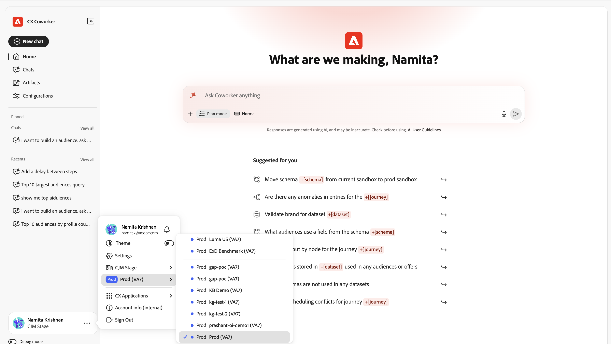
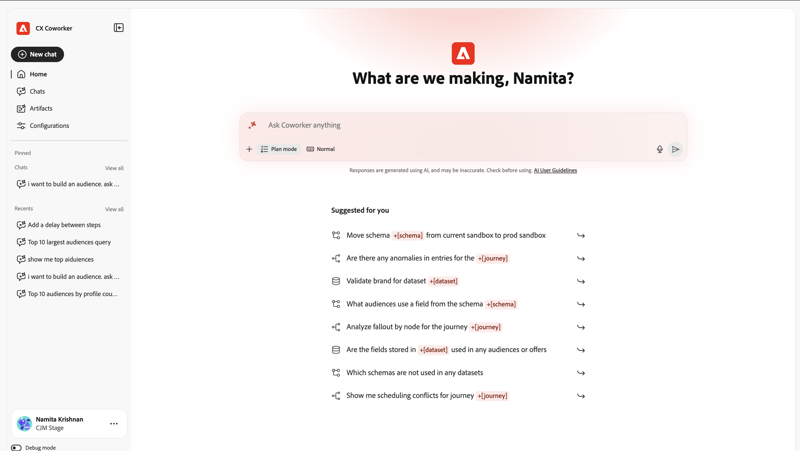
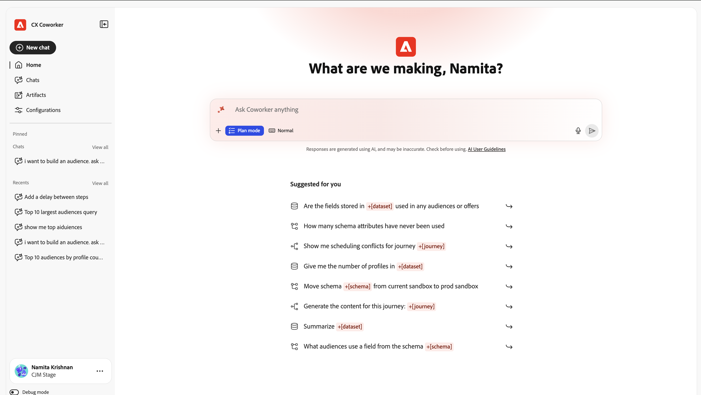

# Introduzione alla chat con i collaboratori {#ui-guide}

Chat con collaboratori consente di lavorare con i dati e gli strumenti di Adobe CX Enterprise chiedendo cosa è necessario in linguaggio semplice. Utilizza questa pagina per aprire Chat con i collaboratori, inviare il primo messaggio e configurarlo nel modo in cui lavori.

>[!VIDEO](https://video.tv.adobe.com/v/3498558?learn=on)

## Disponibilità

La chat per collaboratori è disponibile come esperienza coinvolgente, area di lavoro a pagina intera e come esperienza interna al prodotto in alcune applicazioni CX Enterprise. Per aprire l&#39;esperienza interna al prodotto, fai clic sull&#39;icona Collaboratore  in alto a destra nell&#39;applicazione.

La tabella seguente mostra dove è disponibile ogni esperienza.

| applicazione CX Enterprise | Esperienza coinvolgente | Esperienza nel prodotto |
|---|---|---|
| Real-Time CDP | Disponibile ora | Disponibile a breve |
| Adobe Journey Optimizer | Disponibile ora | Disponibile a breve |
| Customer Journey Analytics | Disponibile ora | Disponibile a breve |
| Workfront | Disponibile ora | In arrivo:  * All’inizio di settembre 2026 nell’istanza di anteprima per alcuni amministratori di sistema Workfront idonei  * A metà settembre 2026 nell’istanza di produzione per i clienti Workfront con rilascio rapido idonei  * A metà ottobre 2026 nell’istanza di produzione per i clienti Workfront con rilascio trimestrale idonei |
| Target | Disponibile ora | Disponibile ora |
| AEM | Disponibile ora | Disponibile ora |
| Marketo Engage | Disponibile ora | Disponibile a breve |

## Apri chat collaboratore {#immersive}

Per utilizzare l&#39;esperienza coinvolgente, accedi con le tue credenziali Adobe. Puoi aprirlo da un collegamento diretto o da CX Enterprise.

1. Vai a [https://experience.adobe.com/#/coworker](https://experience.adobe.com/#/coworker).
1. Accedi con il tuo Adobe ID.

In alternativa, fare clic su **[!UICONTROL Collaboratore]** nel selettore delle applicazioni nell&#39;intestazione di CX Enterprise.

## Imposta il contesto

L’organizzazione e la sandbox determinano quali dati, competenze e strumenti connessi può raggiungere una conversazione. Controllali prima di iniziare. Il contesto corrente viene visualizzato nella parte inferiore della barra di navigazione a sinistra, sotto il tuo nome.

Per modificare il contesto:

1. Fai clic sul tuo nome nella parte inferiore della barra di navigazione per aprire il menu dell’account.
1. Fai clic su **[!UICONTROL Organizzazione]** e scegli l&#39;organizzazione IMS in cui vuoi lavorare.

   

1. Fai clic su **[!UICONTROL Sandbox]** e scegli la sandbox AEP in cui vuoi lavorare.

   

Il menu dell’account include anche le seguenti opzioni:

| Opzione | Utilizzala per |
| --- | --- |
| **[!UICONTROL Tema]** | Passa dai temi Chiaro a Scuro. |
| **[!UICONTROL Impostazioni]** | Visualizza i dettagli dell’account e le impostazioni dell’area di lavoro. |
| **[!UICONTROL Applicazioni CX]** | Passare a un&#39;altra applicazione CX Enterprise connessa al proprio account. |
| **[!UICONTROL Disconnetti]** | Esci dal tuo account Adobe. |

## Trova il modo

L’area di lavoro dispone di due aree: la barra di navigazione a sinistra e l’area di conversazione che riempie il resto della finestra.

Utilizza la barra di navigazione per spostarti tra le parti del prodotto e tornare al lavoro recente.

| Opzione | Utilizzala per |
| --- | --- |
| **[!UICONTROL Nuova chat]** | Inizia una conversazione. Chat collaboratore consente di salvare la chat corrente nella cronologia. |
| **[!UICONTROL Home]** | Tornate al saluto, alla casella di input e ai prompt suggeriti. |
| **[!UICONTROL Chat]** | Cerca, blocca, archivia o elimina le conversazioni passate. |
| **[!UICONTROL Configurazioni]** | Gestisci competenze, server MCP, marketplace, plug-in e memoria. |
| **[!UICONTROL Bloccato]** | Conversazioni aperte che hai interpretato. Fai clic su **[!UICONTROL Visualizza tutti]** per visualizzarli nella pagina Chat. |
| **[!UICONTROL Recenti]** | Apri le ultime conversazioni. Fare clic su **[!UICONTROL Visualizza tutto]** per aprire la pagina Chat. |

## Invia il primo messaggio

La schermata iniziale mostra un saluto, la casella di input e i prompt suggeriti in base a ciò che Cloud Chat può fare nella sandbox. Puoi iniziare con un suggerimento o scrivere un messaggio personalizzato.

Per inviare un messaggio:

1. Fai clic su **[!UICONTROL Home]** nella barra di navigazione.
1. Effettua una delle seguenti operazioni:

   * Seleziona un prompt in **[!UICONTROL Consigliato per te]**. Chat collaboratore lo aggiunge alla casella di input, dove è possibile modificarlo.
   * Immetti la tua richiesta nella casella **[!UICONTROL Chiedi qualsiasi cosa al collega]**.

1. (Facoltativo) Aggiungi contesto, scegli la modalità di risposta di Chat collaboratore o imposta il messaggio. Consulta [Aggiungi contesto e scegli uno stile di risposta](#input-options).
1. Fai clic su **[!UICONTROL Invia]**.

>[!TIP]
>
>I prompt suggeriti mostrano i tipi di attività supportati da Chat con Coworker, ad esempio lo spostamento di schemi tra sandbox, l’individuazione di anomalie in un percorso e la convalida di un set di dati.

Per puntare la chat di Collaboratore a un oggetto specifico nella sandbox, digitare **+** nella casella di input e fare clic su uno schema, un percorso, un set di dati o un altro oggetto. Questo è chiamato menzione di entità. Indica esattamente a Chat collaboratore quale oggetto intendi.

## Aggiungi contesto e scegli uno stile di risposta {#input-options}

La barra degli strumenti sotto la casella di input controlla l&#39;elemento allegato, il modo in cui Chat con il collaboratore affronta l&#39;attività e il lavoro che viene visualizzato.

| Controllo | Utilizzala per |
| --- | --- |
| **[!UICONTROL +]** (Allega) | Aggiungi un file o un oggetto sandbox al messaggio. |
| **[!UICONTROL Modalità piano]** | Rivedi un piano dettagliato prima di utilizzare Chat collaboratrice. |
| **[!UICONTROL Visualizzazione trascrizione]** | Scegli la quantità di attività di Chat con i collaboratori che vedi. |
| **[!UICONTROL Microfono]** | Dettare il messaggio. Fare di nuovo clic per interrompere la registrazione. |
| **[!UICONTROL Invia]** | Invia il messaggio. Mentre la chat di Coworker risponde, questo controllo diventa **[!UICONTROL Interrompi]**, interrompendo la risposta. |

### Allegare un file o un oggetto

Allegare un file o un oggetto quando è necessario disporre di ulteriori informazioni per eseguire l&#39;operazione.

1. Fare clic su **[!UICONTROL +]** nella casella di input.
1. Fare clic su una delle seguenti opzioni:

   * **[!UICONTROL Allega file]**: carica un file per Chat collaboratore per leggerlo e farvi riferimento.
   * **[!UICONTROL Aggiungi dati o oggetto]**: fai riferimento a un oggetto nella sandbox, ad esempio un set di dati o uno schema, in modo che Chat collaboratore funzioni sui tuoi dati live.

### Rivedi un piano prima che il collega Chat agisca {#plan-mode}

Utilizzare la modalità Pianificazione per task complessi o task che modificano dati. Quando la modalità Piano è attiva, Chat collaboratore propone un piano e attende la tua approvazione prima che venga eseguito. Quando la modalità Pianificazione è disattivata, Chat con collaboratori avvia il lavoro immediatamente.

1. Fare clic su **[!UICONTROL Modalità pianificazione]** nella barra degli strumenti di input per attivarla.
1. Invia il messaggio.
1. Rivedi il piano e approvalo per continuare.

### Scegli una vista trascrizione

La vista Trascrizione controlla la quantità di ragionamento e di attività degli strumenti di Chat collaboratrice che appare nella conversazione.

1. Fare clic su **[!UICONTROL Vista trascrizione]** nella barra degli strumenti di input.
1. Fare clic su una visualizzazione:

   | Visualizzazione | Cosa vedi |
   | --- | --- |
   | **[!UICONTROL Normale]** | Riepilogo dei passaggi di pensiero chiave e dell’attività dello strumento. |
   | **[!UICONTROL Attiva]** | Principalmente la risposta. Chat con i collaboratori nasconde la maggior parte dei passaggi intermedi. |
   | **[!UICONTROL Dettagliato]** | Ogni fase di pensiero, carico di abilità, lettura di file e query. |

## Rivedere una risposta

Chat collaboratore mostra il suo lavoro mentre va, quindi restituisce una risposta. Una risposta può includere il suo ragionamento, una registrazione degli strumenti utilizzati, artefatti e un riepilogo.

### Segui l’attività

Mentre la chat di Coworker funziona, puoi seguire e verificare ciò che fa. Espandi qualsiasi voce per visualizzare ulteriori dettagli.

* **Pensato per**: blocco comprimibile con il ragionamento di Chat di Coworker e il tempo necessario.
* **Abilità caricata**: la funzionalità specifica di Chat con collaboratori utilizzata per l&#39;attività.
* **Leggi file** e **Esegui 1 query**: i file letti da Coworker Chat e le query eseguite, con il tempo richiesto da ognuno.

>[!TIP]
>
>Imposta **[!UICONTROL Vista trascrizione]** su **[!UICONTROL Dettagliata]** per visualizzare ogni passaggio oppure su **[!UICONTROL Attiva]** per nasconderli.

### Utilizzare gli artefatti

Chat con collaboratori mostra i risultati, come una tabella di tipi di pubblico, come schede artefatti nella risposta. Puoi scaricare un artefatto di tabella come file CSV dalla relativa scheda. Quando una risposta include più di un artefatto, usa **[!UICONTROL Precedente]** e **[!UICONTROL Successivo]** per spostarti tra di essi.

### Utilizzare il riepilogo

Sotto gli artefatti, Chat con i collaboratori spiega il significato dei risultati, evidenzia i risultati rilevanti e suggerisce azioni di follow-up. Utilizza questi suggerimenti per continuare la conversazione.

### Valuta e copia una risposta

Ogni risposta include controlli che è possibile utilizzare per fornire feedback o riutilizzare il contenuto.

* Fai clic su **[!UICONTROL Miniature in alto]** o **[!UICONTROL Miniature in basso]** per valutare la risposta. La tua valutazione consente di migliorare le risposte future.
* Fai clic su **[!UICONTROL Copia]**, quindi scegli **[!UICONTROL Copia come Markdown]** per mantenere la formattazione o **[!UICONTROL Copia come testo normale]** per rimuoverla.

## Gestire le chat

La cronologia della chat conserva le conversazioni precedenti in modo da potervi tornare. Fai clic su **[!UICONTROL Chat]** nella barra di navigazione per aprirla. Le conversazioni sono raggruppate per data e ogni riga mostra il titolo e il numero di giri.

Nella pagina Chat è possibile:

* Immettere un nome in **[!UICONTROL Cerca per titolo]** per trovare una conversazione.
* Fai clic su **[!UICONTROL Mostra bloccati]** per visualizzare solo le conversazioni che hai visto.
* Fai clic su **[!UICONTROL Mostra archiviati]** per visualizzare le conversazioni archiviate.
* Fai clic su **[!UICONTROL Nuova chat]** per avviare una conversazione.

Per fissare, rinominare, archiviare o eliminare una conversazione, fare clic sul menu di riga (**[!UICONTROL ...]**) nella riga corrispondente e scegliere un&#39;opzione.

## Personalizza chat del collaboratore

Nelle configurazioni puoi controllare le funzionalità di Chat con i collaboratori. Fai clic su **[!UICONTROL Configurazioni]** nella barra di navigazione, quindi scegli una scheda: **[!UICONTROL Abilità]**, **[!UICONTROL Server MCP]**, **[!UICONTROL Marketplace]**, **[!UICONTROL Plugin]** o **[!UICONTROL Memoria]**.

### Aggiungi e visualizza abilità

Le abilità sono funzionalità specializzate utilizzate automaticamente da Chat collaboratore quando vengono applicate. È inoltre possibile avviare un&#39;abilità digitando **/** nella chat. Nella scheda **[!UICONTROL Abilità]** sono elencate tutte le abilità installate.

1. Nella scheda **[!UICONTROL Abilità]**, fai clic su **[!UICONTROL Aggiungi Source]** per installare le abilità da una nuova origine.
1. Immetti un nome in **[!UICONTROL Ricerca]** per trovare un&#39;abilità. Utilizza l’interruttore di visualizzazione per passare da un layout a griglia a uno a elenco e viceversa.
1. Seleziona un’abilità per visualizzare il plug-in a cui appartiene, quando viene utilizzato da Chat con i colleghi, e i file che include.

   

1. (Facoltativo) Fai clic su **[!UICONTROL Visualizza abilità.md]** per leggere la definizione di abilità completa, oppure fai clic su **[!UICONTROL Rimuovi Source]** per disinstallare l&#39;abilità.

   

### Connessione dei server MCP

I server MCP (Model Context Protocol) collegano Chat collaboratore a strumenti e servizi esterni, come Adobe Journey Optimizer, Real-Time CDP, Target e Workfront. Nella scheda **[!UICONTROL Server MCP]** sono elencati i server connessi e il numero di connessioni attive. Ogni scheda mostra il nome del server, il relativo endpoint e i tag che descrivono ciò che fornisce.

Per connettere un server, fare clic su **[!UICONTROL Aggiungi server]** e seguire le istruzioni.

### Aggiungere un marketplace

Un marketplace è un registro di plug-in da cui è possibile sfogliare e installare. Nella scheda **[!UICONTROL Marketplace]**, fai clic su **[!UICONTROL Aggiungi Marketplace]** per registrarne uno nuovo. Usa **[!UICONTROL Ricerca]** o filtra per gruppo per restringere l&#39;elenco. Un marketplace con stato **Pronto** è disponibile per l&#39;installazione da.

### Gestire i plug-in

Un plug-in riunisce le competenze e i server MCP in modo da poterli installare e gestire insieme. La scheda **[!UICONTROL Plug-in]** mostra i plug-in installati.

* Fai clic su **[!UICONTROL Sfoglia Marketplace]** per trovare nuovi plug-in.
* Filtra per marketplace per vedere da dove proviene ogni plug-in.
* Fai clic su **[!UICONTROL Disinstalla]** per rimuovere un plug-in e tutti gli elementi da esso raggruppati.

### Gestione della memoria

La memoria consente a Chat collaboratore di ricordare le tue preferenze nelle conversazioni, in modo che le risposte rimangano pertinenti nel tempo. Utilizza la scheda **[!UICONTROL Memoria]** per controllare ciò che contiene.

1. Fare clic su **[!UICONTROL Memoria]** nella pagina Configurazioni.
1. Attiva **[!UICONTROL Attiva memoria]**. Disattivala per impedire a Chat collaboratore di ricordare tra sessioni diverse.
1. In **[!UICONTROL Preferenze memorizzate]**, controlla cosa ha salvato la chat di Coworker. È possibile modificare, eliminare o controllare ogni voce e filtrare le voci per categoria.
1. Utilizza **[!UICONTROL Cronologia memorie salvate]** per visualizzare una sequenza temporale delle modifiche apportate ai tuoi ricordi.

