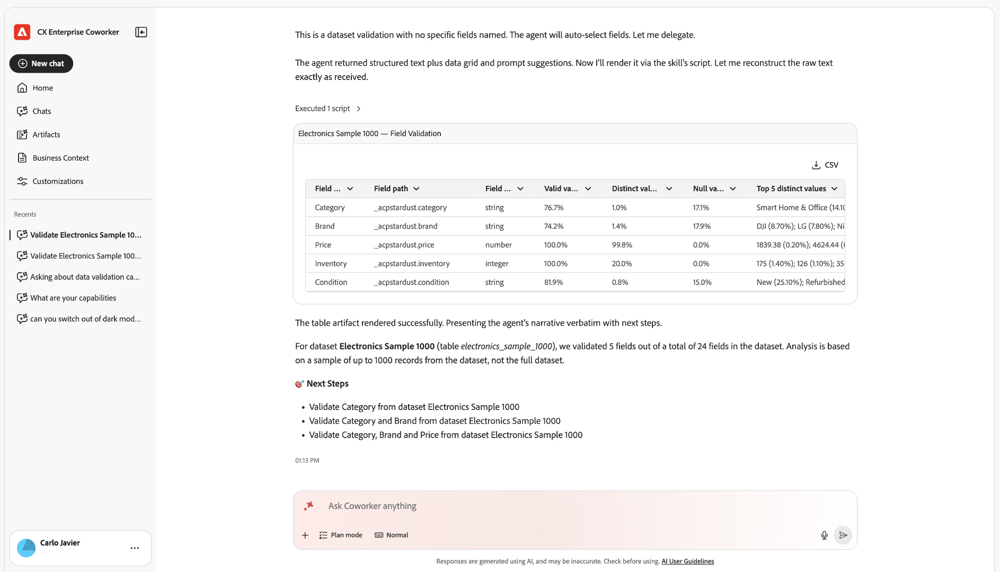

# Panoramica intelligente sull&#39;implementazione e l&#39;amministrazione

Utilizza Adobe CX Enterprise Coworker Chat per configurare, migrare e gestire l’implementazione di Analytics e per assicurarti di poter fidarti dei dati dietro ogni risposta. Il collaboratore può pianificare la tua implementazione, trasformare il piano in un elenco di controllo di cui il team può tenere traccia e convalidare i dati dopo che sono stati raccolti.

L’implementazione e l’amministrazione intelligenti sono uno dei numerosi domini di analisi disponibili in Chat con collaboratori. Per visualizzare tutti i domini, vedere [Avviare l&#39;analisi in Chat di Coworker](/help/chat/use-cases/data-insights/analytics-overview.md#start-analyzing-in-coworker-chat) in Analizzare i dati con Chat di Coworker.

**Ideale per:** Amministratore

## Integrazione del flusso di lavoro di implementazione

I casi d’uso in questa pagina seguono un flusso di lavoro facoltativo in tre fasi. È possibile utilizzare qualsiasi stadio da solo. Ad esempio, puoi convalidare i dati senza prima generare un piano o un elenco di controllo.

1. **Piano:** Ottieni un piano di implementazione o aggiornamento personalizzato e ordinato. Vedi [Pianifica la tua implementazione con Coworker](/help/chat/use-cases/data-insights/implementation-guide.md).
1. **Implementa:** converti il tuo piano in un elenco di controllo nei progetti Coworker che il tuo team può assegnare e monitorare. Consulta [Generare un elenco di controllo dell&#39;implementazione con Progetti coworking](/help/chat/use-cases/data-insights/intelligent-checklist.md).
1. **Convalida:** Verificare che i dati siano configurati e raccolti correttamente. Vedi i casi di utilizzo della convalida nella tabella [Casi di utilizzo](#use-cases).

## Prerequisiti

<!-- FLAG: Confidence: Medium for the shared bullets. They differ from the other domain pages on purpose: planning doesn't query your data, and Experience Platform validation uses Experience Platform datasets rather than data views or report suites. The permission inheritance for Experience Platform is inferred. High for the "Additional prerequisite" notes in the Use cases table, which are sourced from the "Before you begin" section of each linked article. Some of those articles flag their own prerequisites as unconfirmed (implementation-guide.md, intelligent-checklist.md, streaming-media-validation.md), so verify those rows when those flags are resolved. Validate dataset quality for Customer Journey Analytics is a video page with no stated prerequisites, so it isn't listed. -->

Per utilizzare i casi d’uso in questa pagina, è necessario:

* Accesso a Chat con i collaboratori. Vedi [Introduzione all&#39;analisi dei dati con Chat di Coworker](/help/chat/use-cases/data-insights/analytics-chat.md).
* Accesso in visualizzazione ai dati da convalidare. Chat con i collaboratori eredita le autorizzazioni dalle applicazioni Adobe a cui si connette.

## Casi d’uso

| Caso d’uso | Funzione |
| --- | --- |
| [Pianifica l&#39;implementazione](/help/chat/use-cases/data-insights/implementation-guide.md)

 | Crea un piano personalizzato e dettagliato per l’implementazione di Customer Journey Analytics, l’aggiornamento da Adobe Analytics o la configurazione di Content Analytics, Marketing Campaign Analytics o Streaming Media Collection su Edge. I piani includono dettagli quali proprietari, stime dello sforzo, dipendenze e passaggi di convalida.
**Prompt di esempio:** &quot;Aiutami a pianificare la mia implementazione di Customer Journey Analytics&quot;

**Prerequisiti aggiuntivi:** Oltre ai [prerequisiti generali](#prerequisites), questo caso d&#39;uso richiede anche di sapere quale percorso di implementazione si applica all&#39;utente e i dettagli di base sull&#39;ambiente corrente, ad esempio lo stato delle licenze o il percorso di acquisizione dei dati pianificato.

Per ulteriori informazioni, consulta [Pianificare l&#39;implementazione con Coworker](/help/chat/use-cases/data-insights/implementation-guide.md).
 |
| [Generare un elenco di controllo dell&#39;implementazione](/help/chat/use-cases/data-insights/intelligent-checklist.md)

 
Sperimentale
 | Trasforma il piano di implementazione di Customer Journey Analytics in un elenco di controllo in Progetti coworking, in cui il team può assegnare passaggi, tenere traccia dello stato e aggiungere gate di approvazione.
**Prerequisiti aggiuntivi:** Oltre ai [prerequisiti generali](#prerequisites), questo caso d&#39;uso richiede anche una conversazione completata nella guida all&#39;implementazione e l&#39;accesso ai progetti di collaborazione nella tua organizzazione.

Per ulteriori informazioni, vedere [Generare un elenco di controllo dell&#39;implementazione con Progetti coworking](/help/chat/use-cases/data-insights/intelligent-checklist.md).
 |
| [Convalida dati durante l&#39;aggiornamento da Adobe Analytics a Customer Journey Analytics](/help/chat/use-cases/data-insights/data-validation-aa-cja.md)

 | Confronta dimensioni, metriche e tendenze tra le suite di rapporti di Adobe Analytics e le visualizzazioni dati di Customer Journey Analytics, segnala le discrepanze e consiglia di apportare correzioni per supportare l’aggiornamento.
**Ideale per:** Amministratore, Analista

**Richieste di esempio:**
<ul><li>&quot;Confronta la suite di rapporti AA con la visualizzazione dati di CJA&quot;</li><li>&quot;Quali metriche non corrispondono tra AA e CJA?&quot;</li></ul>
**Prerequisiti aggiuntivi:** Oltre ai [prerequisiti generali](#prerequisites), questo caso d&#39;uso richiede anche la suite di rapporti di Adobe Analytics da convalidare e la visualizzazione dati di Customer Journey Analytics che contiene gli stessi dati.

Per ulteriori informazioni, vedere [Convalidare i dati con Coworker durante l&#39;aggiornamento da Adobe Analytics a Customer Journey Analytics](/help/chat/use-cases/data-insights/data-validation-aa-cja.md).
 |
| [Convalida l&#39;implementazione di Streaming Media](/help/chat/use-cases/data-insights/streaming-media-validation.md)

 
Sperimentale
 | Controlla lo stream di dati, lo schema, il set di dati, la visualizzazione dati e i dati della sessione per verificare che il tracciamento dei contenuti multimediali in streaming sia configurato e che la raccolta dei dati sia corretta.
**Prompt di esempio:** &quot;L&#39;implementazione dei contenuti multimediali in streaming è complessivamente valida?&quot;

**Prerequisiti aggiuntivi:** Oltre ai [prerequisiti generali](#prerequisites), questo caso d&#39;uso richiede anche che i dati Experience Platform e Customer Journey Analytics dell&#39;organizzazione siano connessi a Coworker. Per alcune modalità di convalida, è inoltre necessario disporre di un ID di sessione video o di un file di registro.

Per ulteriori informazioni, consulta [Convalidare l&#39;implementazione di Streaming Media con Coworker](/help/chat/use-cases/data-insights/streaming-media-validation.md).
 |
| [Convalida qualità set di dati per Customer Journey Analytics](/help/chat/use-cases/data-insights/validate-dataset-quality-for-cja.md)

 
Sperimentale (settimana prossima)
 | Identifica i set di dati che alimentano i rapporti di Customer Journey Analytics, quindi controlla gli schemi, la qualità dell’identità e la qualità dei campi in modo da poter risolvere i problemi prima di creare dashboard.
Per ulteriori informazioni, vedere [Convalidare i dati di Customer Journey Analytics con l&#39;abilità di convalida dei dati in Coworker](/help/chat/use-cases/data-insights/validate-dataset-quality-for-cja.md).
 |
| [Convalida dati dopo l&#39;acquisizione in Experience Platform](/help/chat/use-cases/data-insights/data-validation-aep.md)

 | Esegue controlli statistici e semantici sui set di dati e sui campi di Experience Platform per individuare problemi di qualità dei dati, ad esempio valori non validi o problemi di mappatura, dopo una nuova implementazione o come parte della gestione dei dati in corso.
**Richieste di esempio:**
<ul><li>&quot;Convalida il set di dati [nome set di dati]&quot;</li><li>&quot;Convalida il [campo dati] dal set di dati [nome set di dati]&quot;</li></ul>
**Prerequisiti aggiuntivi:** Oltre ai [prerequisiti generali](#prerequisites), questo caso d&#39;uso richiede anche il nome o l&#39;ID del set di dati da convalidare. Facoltativamente, puoi fornire il nome di un campo specifico da convalidare.

Per ulteriori informazioni, consulta [Convalidare i dati di Experience Platform con Coworker](/help/chat/use-cases/data-insights/data-validation-aep.md).
 |
| [Accelera approfondimenti dati](/help/chat/use-cases/data-insights/accelerate-data-insights.md) | Mostra in un video come Cooker pianifica l’implementazione, esegue le azioni supportate e guida i passaggi di prodotto e sviluppo in Adobe Experience Manager, Experience Platform, Web SDK e Customer Journey Analytics fino a quando i dati di coinvolgimento del sito web non sono pronti per l’analisi.
Per ulteriori informazioni, consulta [Accelerare gli approfondimenti sui dati con Coworker, AEM e CJA](/help/chat/use-cases/data-insights/accelerate-data-insights.md).
 |

## Abilità utilizzate

<!-- FLAG: Confidence: High for `aa-cja-validation` (listed in the Skills and limitations table and in workflows.md). Medium for `data-validation`: workflows.md lists it, but with a TODO to confirm the skill ID with engineering. Medium for the implementation guide skills and the Streaming Media Validation skill: the articles name them but don't give technical skill IDs, so they're listed by display name. Only `aa-cja-validation` currently appears in the Skills and limitations table on analytics-overview.md. Add the others there so the link below covers them. -->

Per i casi d’uso descritti in questo articolo, il collaboratore utilizza le seguenti competenze. Per un elenco di tutte le abilità di analisi, incluse le autorizzazioni necessarie e quelle che non coprono, consulta [Abilità e limitazioni](/help/chat/use-cases/data-insights/analytics-overview.md#skills-and-limitations) in Analizzare i dati con Chat con collaboratori.

| Competenza | Utilizzato per |
| --- | --- |
| Competenze nella guida all’implementazione (una per Customer Journey Analytics, un aggiornamento da Adobe Analytics a Customer Journey Analytics, Content Analytics, Marketing Campaign Analytics e Streaming Media) | Pianificare l’implementazione |
| `aa-cja-validation` | Convalidare i dati durante l’aggiornamento da Adobe Analytics a Customer Journey Analytics |
| Competenza di convalida di contenuti multimediali in streaming | Convalidare l’implementazione di Streaming Media |
| Competenza di convalida dei dati (`data-validation`) | Convalida qualità set di dati per Customer Journey Analytics Convalida dati dopo l&#39;acquisizione in Experience Platform |

## Suggerimenti per ottenere risultati migliori

* Denomina la suite di rapporti e la visualizzazione dati specifiche che desideri confrontare durante la convalida dei dati.
* Utilizza i risultati della convalida come guida per le tue modifiche. Le abilità di convalida di Streaming Media e di convalida dei dati identificano i problemi ma non modificano la configurazione o i dati.
* Esegui nuovamente la convalida di Streaming Media dopo ogni modifica dell’implementazione. Viene eseguito su richiesta e non fornisce monitoraggio continuo.
* Utilizza le abilità della guida all’implementazione solo per la pianificazione. Non accedono ai sistemi Adobe né eseguono l’implementazione.

## Passaggi successivi

* Per una panoramica dell&#39;analisi dei dati con Chat di Coworker, inclusi gli altri domini di analisi e le best practice, consulta [Analizzare i dati con Chat di Coworker](/help/chat/use-cases/data-insights/analytics-overview.md).
* Per impostare la chat di Coworker e seguire un esempio di lavoro, vedere [Introduzione all&#39;analisi dei dati con la chat di Coworker](/help/chat/use-cases/data-insights/analytics-chat.md).
