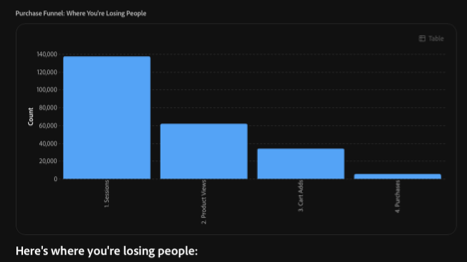

# Panoramica sull’analisi del percorso

<!-- FLAG: Confidence: High for the first sentence and "Best for" (carried over from analytics-overview.md). Medium for the second sentence, which summarizes the row descriptions from the slides. -->

Utilizza Adobe CX Enterprise Coworker Chat per scoprire dove i clienti abbandonano il percorso per convertirsi e perché, su canali, dispositivi e segmenti diversi. Descrivi il percorso in un linguaggio semplice e Chat con collaboratori crea il funnel, mostra il calo a ogni passaggio e ti aiuta a indagare la causa.

L’analisi del percorso è uno dei numerosi domini di analisi disponibili in Chat con coorker. Per visualizzare tutti i domini, vedere [Avviare l&#39;analisi in Chat di Coworker](/help/chat/use-cases/data-insights/analytics-overview.md#start-analyzing-in-coworker-chat) in Analizzare i dati con Chat di Coworker.

**Ideale per:** analista, utente aziendale

## Prerequisiti

Per utilizzare i casi d’uso in questa pagina, è necessario:

* Chat con collaboratori connessa alle visualizzazioni dati di Customer Journey Analytics o alle suite di rapporti di Adobe Analytics. Vedi [Introduzione all&#39;analisi dei dati con Chat di Coworker](/help/chat/use-cases/data-insights/analytics-chat.md).
* Accesso alle visualizzazioni dati o alle suite di rapporti che desideri analizzare. La chat per collaboratori eredita le autorizzazioni da Customer Journey Analytics o Adobe Analytics.

## Casi d’uso

| Caso d’uso | Funzione |
| --- | --- |
| [Analizzare i dati di Customer Journey Analytics e Adobe Analytics](/help/chat/use-cases/data-insights/analytics-chat.md)

 | Risponde alle domande in linguaggio naturale sulle visualizzazioni di dati o sulle suite di rapporti, crea funnel e altre visualizzazioni e trova dove i clienti abbandonano. Puoi aprire qualsiasi visualizzazione in Analysis Workspace per ulteriori analisi.
**Prompt di esempio:** &quot;Mostra visualizzazioni di pagina per gli ultimi 30 giorni&quot;

Per ulteriori informazioni, vedere [Introduzione all&#39;analisi dei dati con Chat di Collaboratore](/help/chat/use-cases/data-insights/analytics-chat.md).
 |
| [Individuare la destinazione dei clienti](/help/chat/use-cases/data-insights/analytics-overview.md#skills-and-limitations) | Crea un funnel da una domanda semplice, classifica le perdite più grandi e suggerisce i passaggi successivi.
**Ideale per:** utente aziendale

**Richieste di esempio:**
<ul><li>&quot;Dove stiamo perdendo la gente sulla via dell&#39;acquisto?&quot;</li><li>&quot;Passami attraverso il funnel di pagamento&quot;</li></ul>
Per ulteriori informazioni, consulta [Abilità e limitazioni](/help/chat/use-cases/data-insights/analytics-overview.md#skills-and-limitations).
 |
| Diagnosi delle conversioni rifiutate | Analizza dove i clienti abbandonano e valuta quali fattori hanno contribuito al cambiamento.
**Richieste di esempio:**
<ul><li>&quot;Perché le conversioni sono calate la settimana scorsa?&quot;</li><li>&quot;Dove hanno abbandonato i clienti dopo il cambiamento del sito?&quot;</li></ul> |
| Isolare la causa di un calo | Se si esclude il problema, viene isolato uno alla volta il canale, il dispositivo o il segmento che si trova dietro il problema.
**Richieste di esempio:**
<ul><li>&quot;L’abbandono del carrello è peggiore su dispositivi mobili o desktop?&quot;</li><li>&quot;Quali canali perdono di più tra il carrello e l’acquisto?&quot;</li></ul> |
| Confronta percorsi tra periodi | Mostra, passo dopo passo, se le modifiche spedite hanno spostato il funnel.
**Ideale per:** utente aziendale

**Richieste di esempio:**
<ul><li>&quot;Confronta conversione pagamento di questo trimestre con l’ultimo trimestre&quot;</li><li>&quot;Come è cambiato il funnel dopo la riprogettazione?&quot;</li></ul> |

## Esempio: individuare il punto di partenza dei clienti

Per una conversazione di esempio completa, dalla prima domanda a un consiglio, vedere [Esempio: Trovare il punto in cui i clienti abbandonano](/help/chat/use-cases/data-insights/analytics-chat.md#example-find-where-customers-drop-off) in Introduzione all&#39;analisi dei dati con Chat con collaboratori.

## Abilità utilizzate

<!-- FLAG: Confidence: High for `cja` and `aa` (the Skills and limitations table lists funnel and fallout analysis and side-by-side comparison of time periods). Medium for the root cause analysis skills: workflows.md maps the prompt "Why did conversions drop last week?" to them, but the mapping to the slide rows "Diagnose conversion declines" and "Isolate the cause of a drop-off" is inferred. Confirm with the PM. -->

Per i casi d’uso descritti in questo articolo, il collaboratore utilizza le seguenti competenze. Per un elenco di tutte le abilità di analisi, incluse le autorizzazioni necessarie e quelle che non coprono, consulta [Abilità e limitazioni](/help/chat/use-cases/data-insights/analytics-overview.md#skills-and-limitations) in Analizzare i dati con Chat con collaboratori.

| Competenza | Utilizzato per |
| --- | --- |
| `cja`, `aa` | Analizza i dati di Customer Journey Analytics e Adobe Analytics Individua i clienti che abbandonano Confronta i percorsi tra periodi diversi |
| `cja-root-cause-analysis`, `aa-root-cause-analysis` | Diagnostica conversioni rifiutate Isolare la causa di un abbandono |

## Suggerimenti per ottenere risultati migliori

<!-- FLAG: Confidence: High, except the first bullet (Medium), which moved here from Prerequisites and is inferred from how funnel prompts work. The rest are adapted from the best practices in analytics-overview.md. -->

* Assegna un nome ai passaggi di percorso che desideri analizzare, ad esempio pagina prodotto, carrello, pagamento e acquisto.
* Denomina le dimensioni, le metriche e l’intervallo di date che desideri analizzare e fai riferimento ai componenti in base al loro nome esatto.
* Chiedi una visualizzazione funnel o Abbandono se è quello che desideri visualizzare.
* Specifica i segmenti, i canali o i dispositivi da includere, escludere o confrontare.
* Fai riferimento a qualsiasi ipotesi già in tuo possesso, ad esempio una recente modifica del sito, in modo che Chat con i collaboratori possa convalidarla o escluderla.
* Chiedi i passaggi successivi consigliati se desideri che Chat con collaboratori suggerisca domande di follow-up.
* Apri qualsiasi visualizzazione in Analysis Workspace quando desideri un maggiore controllo manuale.

## Passaggi successivi

* Per una panoramica dell&#39;analisi dei dati con Chat di Coworker, inclusi gli altri domini di analisi e le best practice, consulta [Analizzare i dati con Chat di Coworker](/help/chat/use-cases/data-insights/analytics-overview.md).
* Per impostare la chat di Coworker e seguire un esempio di lavoro, vedere [Introduzione all&#39;analisi dei dati con la chat di Coworker](/help/chat/use-cases/data-insights/analytics-chat.md).
