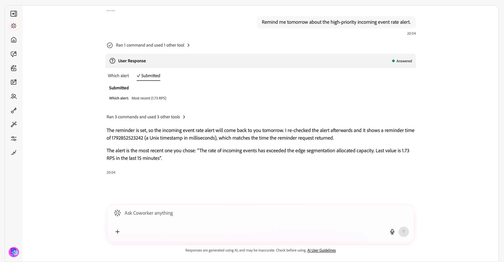

# Competenze di notifica {#notification-skills}

Utilizza le abilità di notifica in Adobe CX Enterprise Coworker per rivedere le notifiche, identificare gli elementi di azione e gestire le preferenze di notifica tramite conversazione. Utilizza le notifiche già ricevute nel pannello delle notifiche in tutte le applicazioni Adobe CX Enterprise.

Riepiloga le notifiche, individua elementi specifici e raggruppa le notifiche ripetute in problemi distinti. Aprire una notifica nell&#39;applicazione, contrassegnarla come letta o non letta o impostare un promemoria.

>[!AVAILABILITY]
>
>Le abilità di notifica sono disponibili per tutti i clienti con accesso ad Adobe CX Enterprise Coworker. Non è necessaria alcuna configurazione aggiuntiva per utilizzare le abilità.
>
>Per ricevere notifiche in [!DNL Slack], l&#39;organizzazione deve disporre di un&#39;area di lavoro [!DNL Slack] connessa.

## Prima di iniziare {#before-you-begin}

Prima di iniziare, si assicuri di avere:

* Accesso ad Adobe CX Enterprise Coworker.
* Accesso a una o più applicazioni Adobe CX Enterprise che inviano notifiche.
* Un&#39;area di lavoro [!DNL Slack] connessa per la tua organizzazione, se desideri ricevere notifiche in [!DNL Slack].

## Rivedere e agire in base alle notifiche {#review-and-act}

Inizia con un riepilogo, quindi perfeziona la richiesta e agisci in base a una notifica specifica.

1. Apri Chat Collaboratore. Per istruzioni, vedere [Introduzione a Chat con Coworker](/help/chat/ui-guide.md).
1. Immetti una richiesta nella casella **[!UICONTROL Chiedi qualsiasi cosa al collega]**, quindi seleziona **[!UICONTROL Invia]**. Ad esempio:

   *&quot;Cosa richiede la mia attenzione oggi?&quot;*

1. Rivedi le notifiche che richiedono un’azione e quelle fornite per la consapevolezza.

   

1. Immettere una domanda di follow-up per limitare i risultati. Ad esempio:

   *&quot;Da tali notifiche, sono presenti errori in Experience Platform di cui dovrei essere a conoscenza?&quot;*

   

1. Richiedere dettagli su una notifica o aprirla nella relativa applicazione per indagare.
1. Chiedere di contrassegnare una notifica come letta o impostare un promemoria. Ad esempio:

   *&quot;Ricordami domani dell&#39;avviso sulla frequenza degli eventi in arrivo ad alta priorità.&quot;*

   

Continua la conversazione senza ripetere il contesto delle richieste precedenti. Se la richiesta può essere applicata a più notifiche, applicazioni o impostazioni, rispondere alla domanda chiarificatrice prima di procedere.

Ricevi una richiesta di conferma prima di una modifica che va oltre la richiesta.

## Casi d’uso supportati {#supported-use-cases}

Utilizza le abilità di notifica per rivedere le notifiche che ti vengono inviate, agire su di esse e gestire come riceverle.

>[!NOTE]
>
>Le abilità di notifica non inviano, condividono o eliminano notifiche.

### Identificare le azioni {#identify-action-items}

Chiedi quali notifiche richiedono la tua attenzione in tutte le applicazioni Adobe CX Enterprise.

Esempio di prompt:

* &quot;Cosa richiede la mia attenzione oggi?&quot;
* &quot;Recuperami.&quot;
* &quot;C&#39;è qualcosa che mi aspetta?&quot;

### Riepiloga notifiche {#summarize-notifications}

Richiedere un riepilogo per un periodo di tempo o un&#39;applicazione. Esamina le azioni separatamente dalle notifiche fornite per la consapevolezza. Le notifiche ripetute sono raggruppate in problemi distinti anziché essere elencate singolarmente.

Esempio di prompt:

* &quot;Riepiloga le notifiche della settimana scorsa.&quot;
* &quot;Offrimi una panoramica delle mie notifiche dell’ultimo giorno&quot;.
* &quot;Riepiloga le notifiche Adobe Journey Optimizer&quot;

### Trovare notifiche specifiche {#find-specific-notifications}

Filtra le notifiche in base a criteri quali stato non letto, richieste di approvazione, errori, errori o rilasci di prodotti.

Esempio di prompt:

* &quot;Mostra solo le notifiche non lette&quot;
* &quot;Mostra le mie richieste di approvazione&quot;
* &quot;Esistono avvisi di errori critici di cui dovrei essere a conoscenza?&quot;
* &quot;Mostrami le notifiche di rilascio per Experience Platform&quot;.

### Rivedi i dettagli delle notifiche {#review-notification-details}

Richiedi i dettagli completi di una notifica così come è stata inviata. Se più notifiche corrispondono alla richiesta, specifica quale intendi.

Esempio di prompt:

* &quot;Ulteriori informazioni sulla notifica di percorso.&quot;
* &quot;Cosa significa per me questo avviso?&quot;

### Agisci sulle notifiche {#act-on-notifications}

Aprire una notifica nella relativa applicazione, contrassegnare le notifiche come lette o non lette o impostare un promemoria. Scegli un promemoria per cinque minuti, 15 minuti, un&#39;ora o domani.

Esempio di prompt:

* &quot;Contrassegna la notifica come già letta.&quot;
* &quot;Contrassegna la notifica come non letta.&quot;
* &quot;Ricordami di questa notifica tra un&#39;ora.&quot;
* &quot;Contrassegna tutte le notifiche come lette.&quot;

### Gestisci le preferenze per le notifiche {#manage-notification-preferences}

Chiedi informazioni sulle impostazioni correnti prima di modificare la modalità di ricezione delle notifiche. Specificare l&#39;applicazione o la categoria di notifica da aggiornare.

| Preferenza | Modifiche disponibili |
| --- | --- |
| Canali di consegna | Attiva o disattiva le notifiche all&#39;interno dell&#39;applicazione, le notifiche e-mail o le notifiche [!DNL Slack] per un&#39;applicazione o una categoria. |
| Frequenza e-mail | Scegli la consegna immediata via e-mail o un riepilogo giornaliero o settimanale. |
| Priorità categoria | Scegli quali categorie di notifica hanno priorità alta. |
| Avvisi popup | Scegliere le categorie di notifica che visualizzano gli avvisi popup. |

Esempio di prompt:

* &quot;Quali sono le impostazioni di notifica per Adobe Journey Optimizer?&quot;
* &quot;Disabilita le notifiche [!DNL Slack] per Experience Platform.&quot;
* &quot;Cambia il riepilogo giornaliero a settimanale.&quot;
* &quot;Disattiva le notifiche di aggiornamento della versione.&quot;
* &quot;Invia notifiche Adobe Journey Optimizer solo tramite e-mail.&quot;

Se Chat collaboratore richiede dettagli sulla pianificazione, specifica il giorno, l’ora e il fuso orario per il riepilogo settimanale.

## Ulteriori informazioni su questo argomento {#more-help}

Utilizza queste guide per iniziare a usare Chat con i collaboratori o per indagare sull’attività di allarme di Experience Platform.

* [Introduzione alla chat con i collaboratori](/help/chat/ui-guide.md)
* [Competenze di avviso cliente](/help/chat/use-cases/customer-alerts/customer-alerts.md)
