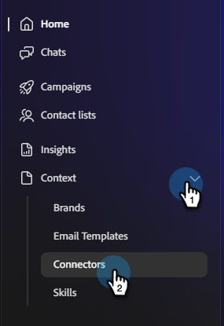

# Connetti a database {#databricks}

Collaboratore per team consente di connettersi ed eseguire query sulle tabelle del catalogo Unity nell’area di lavoro Database per generare e attivare i tipi di pubblico della campagna.

>[!PREREQUISITES]
>
>Per utilizzare questo connettore, è necessario disporre innanzitutto di:
>
>* Un account Databricks attivo
>* Host Workspace Databricks, [Percorso warehouse SQL](https://docs.databricks.com/aws/en/compute/sql-warehouse/create){target="_blank"}, [Token di accesso personale](https://learn.microsoft.com/en-us/azure/databricks/dev-tools/auth/pat){target="_blank"} e [Cataloghi Unity](https://learn.microsoft.com/en-us/azure/databricks/discover/database-objects){target="_blank"} utili.

## Come collegarsi

1. Nella home page di [Collaboratore per team](https://coworker-campaigns.experience.adobe.com/){target="_blank"}, fare clic su **Contesto** e selezionare **Connettori**.

   

1. Fare clic su **Aggiungi integrazione**.

   

   >[!NOTE]
   >
   >Se questa non è la prima integrazione, il pulsante indicherà &quot;Aggiungi connettore&quot;.

1. Nella riga Database fare clic su **Connetti**.

   

1. Immetti il tuo **host Workspace**, **percorso warehouse SQL**, **token di accesso personale** e **cataloghi Unity**. Fai clic su **Connetti**.

   >[!NOTE]
   >
   >Nella home page del database, l’host Workspace si trova direttamente nella barra degli indirizzi del browser in uso. Per individuare tutte le altre credenziali, consulta i collegamenti in **Prerequisiti** nella parte superiore di questo articolo.

   

Una volta stabilita la connessione, i database verranno visualizzati nell&#39;elenco Connettori.

**Per disconnettersi:**

1. Nella schermata Connettori, individua il riquadro Database e fai clic su **Gestisci**.

1. Fai clic su **Disconnetti** (al momento non è necessario reimmettere il token di accesso personale).

1. Fai di nuovo clic su **Disconnetti** per confermare.
