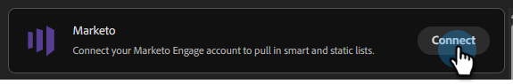
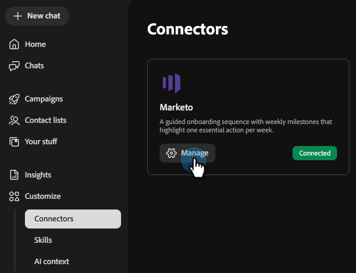

# Connetti a Marketo Engage {#marketo}

Collaboratore per team consente di collegare il tuo account Marketo Engage per richiamare elenchi statici e intelligenti.

>[!PREREQUISITES]
>
>Per utilizzare questo connettore, è necessario disporre innanzitutto di:
>
>* Un account Marketo Engage attivo
>* L&#39;URL dell&#39;**istanza** di Marketo
>* Un [servizio personalizzato](https://experienceleague.adobe.com/en/docs/marketo-developer/marketo/rest/custom-services#custom-services-1){target="_blank"} creato per Coworker per i team in Marketo, con [ID client e segreto client](https://experienceleague.adobe.com/en/docs/marketo-developer/marketo/rest/authentication#creating-an-access-token){target="_blank"} disponibili

## Come collegarsi

1. Nella home page di [Collaboratore per team](https://coworker-campaigns.experience.adobe.com/){target="_blank"}, fare clic su **Contesto** e selezionare **Connettori**.

   

1. Fare clic su **Aggiungi integrazione**.

   

   >[!NOTE]
   >
   >Se questa non è la prima integrazione, il pulsante indicherà &quot;Aggiungi connettore&quot;.

1. Nella riga Marketo, fai clic su **Connetti**.

   

1. Immetti l&#39;**URL istanza**, l&#39;**ID client** e il **Segreto client** di Marketo. Fai clic su **Connetti**.

   >[!NOTE]
   >
   >Puoi trovare l’URL dell’istanza di Marketo nella barra degli indirizzi del browser quando visualizzi la pagina My Marketo.

   

Dopo la connessione, Marketo viene visualizzato nell&#39;elenco Connettori e può essere selezionato quando si collega un elenco di contatti per la sincronizzazione da Marketo.

**Per disconnettersi:**

1. Nella schermata Connettori, individua il riquadro Marketo e fai clic su **Gestisci**.

   

1. Fai clic su **Disconnetti** (al momento non è necessario immettere nuovamente il segreto client).

   

   >[!NOTE]
   >
   >Dopo la prima aggiunta dell&#39;URL dell&#39;istanza, per impostazione predefinita viene utilizzato l&#39;URL dell&#39;endpoint REST, che termina con `*.mktorest.com`.

1. Fai di nuovo clic su **Disconnetti** per confermare.

   
