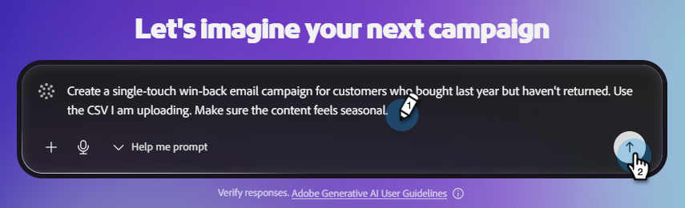

# Creare una campagna e-mail {#create-an-email-campaign}

Scopri come generare e rivedere in pochi minuti campagne e-mail complete.

## Prima di iniziare

Assicurati di avere:

* Un account Adobe CX Enterprise Coworker for teams attivo ([registrati qui](https://coworker-campaigns.experience.adobe.com/){target="_blank"}, se non lo hai già fatto).

* Il brand aggiunto in **Contesto** > **Marchi**.

* (Facoltativo ma consigliato) Un modello e-mail di HTML caricato in **Contesto** > **Modelli e-mail**.

* Un CSV di pubblico pronto per il caricamento.

* Un’idea chiara dell’obiettivo della campagna (ad esempio, &quot;riconquistare clienti inattivi&quot; o &quot;invitare utenti di prova a un webinar&quot;).

## Passaggio 1: avviare una nuova chat

Dalla pagina Home puoi iniziare in tre modi:

**Opzione uno**: digitare un prompt nella barra dei prompt centrale.

_Quando utilizzare: quando si conosce esattamente ciò che si desidera._

**Opzione due**: scegliere un modello pronto nella sezione **Modelli campagna** sotto la barra dei prompt.

_Quando utilizzare: quando non si è sicuri di ciò che si desidera._

**Opzione tre**: utilizzare l&#39;opzione &quot;Help me prompt&quot; dell&#39;elenco a discesa nella barra dei prompt per fare in modo che Coworker for teams ti guidi durante la scrittura del prompt.

_Quando utilizzare: quando si può avere un&#39;idea di ciò che si desidera, ma si desidera un piccolo aiuto (o, utilizzare &quot;Sorpresa&quot; per essere sorpresi)._

{width="800" zoomable="yes"}

## Passaggio 2: creare la richiesta

Un messaggio forte di Collaboratore per team include:

* L’obiettivo della campagna (cosa stai cercando di raggiungere).
* Il pubblico (per chi o da dove provengono i dati del pubblico).
* Formato e struttura (numero di e-mail, cadenza, tono).
* Indicazioni sul marchio o sul contesto (riferimenti al marchio, al prodotto o alla campagna).

Esempio:

`"Create a single-touch win-back email campaign for customers who bought last year but haven't returned. Use the CSV I am uploading. Make sure the content feels seasonal."`

>[!TIP]
>
>Per ulteriori esempi, consulta l&#39;articolo _Casi d&#39;uso_.

>[!NOTE]
>
>Se disponi già di un resoconto di una campagna, caricalo insieme alla tua richiesta come contesto aggiuntivo per il piano che verrà generato per te.

Quando il prompt è pronto, fare clic sull&#39;icona freccia su. Collaboratore per i team:

* Generare una strategia di campagna strutturata.
* Chiedi il pubblico di destinazione, che verrà utilizzato anche per la personalizzazione dei contenuti.
* Crea contenuti e-mail personalizzati per ogni passaggio.
* Costruire dinamicamente il percorso lungo il percorso.
* Assemblalo tutto su una singola bacheca della campagna.

## Passaggio 3: aggiornare il pubblico

I tipi di pubblico vengono caricati tramite CSV. Tutti i tipi di pubblico sono specifici per le rispettive campagne (al momento non vengono memorizzati in nessun altro punto dell’ambiente).

1. Dopo aver inviato la richiesta, Collaboratore per team (in genere) genera un pubblico di esempio per te. In caso contrario, viene richiesto di importare un pubblico.

1. Importa il tuo pubblico caricando un file CSV o importando i dati da un connettore disponibile.

   >[!NOTE]
   >
   >Mentre Collaboratore per team consente di procedere con la creazione della campagna utilizzando un pubblico di esempio, è necessario aggiungere un pubblico reale per avviare la campagna.

   >[!IMPORTANT]
   >
   >Escludi eventuali contatti che non desideri inviare tramite e-mail (utenti non abbonati, indirizzi interni, account di test) prima di caricarli. Anche se attiveremo progressivamente la funzionalità per escludere utenti specifici o aggiungere attributi durante il corso della prova, non sarà immediatamente disponibile dalla data di lancio.

## Passaggio 4: rivedere e perfezionare Campaign Assets

Per apportare modifiche all’e-mail, scorri verso destra. In _Campaign Assets_, fai clic su **Apri editor**.

Esistono due modi per aggiornare il contenuto.

* Apporta manualmente le modifiche desiderate selezionando varie sezioni nell’e-mail (ad esempio: sostituisci l’oggetto, aggiorna un’immagine, ecc.).

-oppure-

* Utilizza l’interfaccia di conversazione per apportare modifiche parlando direttamente con Collaboratore per i team. Alcuni esempi includono:

  * &quot;Rendi l&#39;oggetto più urgente.&quot;
  * &quot;Abbrevia la copia del corpo.&quot;
  * &quot;Rendi il call to action più forte&quot;.

Puoi anche utilizzare i pulsanti AI per perfezionare l’Oggetto o il Preheader.

>[!TIP]
>
>Premi il tasto Esc ogni volta che ti trovi in un editor o in una finestra di dialogo di Campaigns Collaborator (campagne, percorso, ecc.) per uscire rapidamente.

## Passaggio 5: inviare un messaggio e-mail di test

Prima del lancio, invia la campagna a te stesso in modo da poterla esaminare in una vera e propria casella in entrata. Utilizza questa opzione per assicurarti che l’e-mail esegua il rendering nel modo desiderato, che i collegamenti funzionino, che qualsiasi personalizzazione sia accurata e così via.

>[!NOTE]
>
>Al momento, puoi inviare solo un’e-mail di test a te stesso e solo una alla volta.

## Passaggio 6: avviare la campagna

Ora puoi [avviare la tua campagna](/help/coworker-for-teams/launch-manage-campaign.md#launch-a-campaign).

## Domande frequenti

**Perché la prima risposta richiede così tanto tempo?**

Sta generando un’intera campagna per te, inclusi la strategia, il pubblico necessario, il flusso di lavoro, ecc. Il tempo medio della prima risposta con il contenuto generato è in genere di circa un minuto.

**Cosa posso fare se l&#39;output di Coworker for teams non è corretto?**

Fai clic sull’icona del feedback nell’intestazione e inviaci le tue informazioni per migliorare la piattaforma.

**Posso modificare le e-mail direttamente o solo tramite chat?**

Potete fare entrambe.

**Come si salva una campagna senza avviarla?**

Tutte le campagne vengono salvate automaticamente. Se hai bisogno di accedere alle conversazioni recenti, queste sono disponibili nella finestra a sinistra (in **Chat** se non hai creato la tua campagna, in **Campagne** se ne hai).

**Esiste un limite di dimensione per il caricamento del file CSV?**

Sì, la dimensione massima è di 8 MB.

**Cosa succede se il file CSV del pubblico restituisce errori?**

Assicurati che il file CSV non contenga caratteri nascosti &quot;rich&quot;.

**Come posso condividere una bozza di campagna con un compagno di squadra per la revisione?**

Al momento non è presente alcun pulsante &quot;condividi&quot;. Tuttavia, puoi scaricare il contenuto come HTML o esportarlo come documento PDF o Word.
