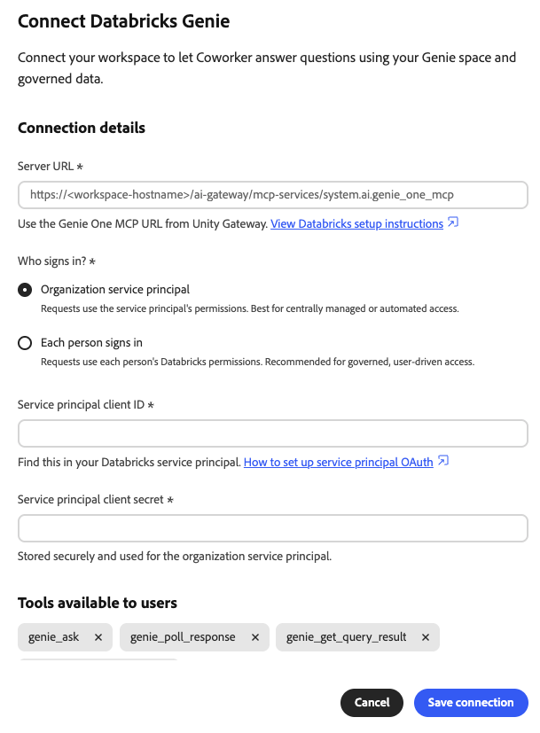

# Connettore esterno Genie Databricks {#databricks-genie}

Utilizza il connettore esterno [!DNL Databricks Genie] per porre domande sui dati di [!DNL Databricks] in linguaggio semplice in Adobe CX Enterprise Coworker. [!DNL Genie] scrive il codice SQL e restituisce le risposte in chat. Il connettore collega Collaboratore al server MCP (Model Context Protocol) [!DNL Genie One] nell&#39;area di lavoro [!DNL Databricks].

>[!AVAILABILITY]
>
>Il connettore esterno [!DNL Databricks Genie] è in versione beta. La documentazione e le funzionalità sono soggette a modifiche.

## Configurazione del connettore {#connector-configuration}

Il processo di configurazione del connettore è costituito da due parti separate:

* **Configurazione dell&#39;organizzazione:** Un amministratore connette Coworker a un&#39;area di lavoro [!DNL Databricks], sceglie il modo in cui gli utenti accedono e seleziona gli strumenti che i membri possono utilizzare.
* **Accesso membri:** I membri utilizzano la connessione con un&#39;identità dell&#39;organizzazione condivisa o con una propria identità [!DNL Databricks], a seconda dell&#39;opzione di accesso.

L&#39;amministratore sceglie una delle seguenti opzioni di accesso:

| Opzione | Informazioni fornite dall&#39;amministratore | Funzionamento dell’accesso |
| --- | --- | --- |
| **[!UICONTROL Entità servizio organizzazione]** | ID client e segreto client di un&#39;entità servizio [!DNL Databricks]. | Tutti i membri utilizzano le autorizzazioni dell&#39;entità servizio. I membri non accedono a [!DNL Databricks]. |
| **[!UICONTROL Ogni persona firma in]** | L&#39;ID client di una connessione all&#39;app OAuth [!DNL Databricks] e un segreto client facoltativo. | Ogni membro accede con la propria identità [!DNL Databricks] e l&#39;accesso segue le proprie autorizzazioni [!DNL Databricks]. |

Nessuna delle due opzioni concede a [!DNL Databricks] le autorizzazioni che l&#39;identità selezionata non ha già. [!DNL Databricks] applica [!DNL Unity Catalog] autorizzazioni su ogni richiesta.

## Prerequisiti {#prerequisites}

Questo connettore funziona con [!DNL Databricks Genie One]. Non supporta gli URL MCP dello spazio [!DNL Genie] legacy. Per connettere un altro server MCP [!DNL Databricks], ad esempio un server [!DNL Databricks SQL], aggiungerlo separatamente come integrazione.

Prima di iniziare, assicurati di disporre dei seguenti elementi:

* **Per la configurazione dell&#39;organizzazione:** un account con l&#39;autorizzazione per gestire i connettori dell&#39;organizzazione in Coworker.
* **Per l&#39;area di lavoro [!DNL Databricks]:** URL HTTPS di un&#39;area di lavoro in cui è disponibile [!DNL Genie One].
* **Per l&#39;opzione dell&#39;entità servizio:** ID client e segreto client di un&#39;entità servizio [!DNL Databricks].
* **Per l&#39;opzione di accesso per persona:** Una connessione all&#39;app OAuth [!DNL Databricks] e il relativo ID client. È inoltre necessario un amministratore [!DNL Databricks] che possa registrare l&#39;URL di reindirizzamento di Collaborator.
* **Per l&#39;accesso [!DNL Databricks]:** autorizzazioni Workspace, [!DNL Genie] e dati per l&#39;identità che verrà utilizzata. Il collaboratore non concede queste autorizzazioni.

>[!IMPORTANT]
>
>Non condividere mai segreti client, token di accesso o altre credenziali in schermate, chat o ticket di supporto.

Per istruzioni, vedere la seguente documentazione di [!DNL Databricks]:

* [Genie One MCP](https://docs.databricks.com/aws/en/agents/mcp-tools/genie-mcp){target="_blank"}
* [Abilitare o disabilitare le applicazioni OAuth partner](https://docs.databricks.com/aws/en/integrations/enable-disable-oauth){target="_blank"}
* [Autorizzare l’accesso dell’entità servizio alle banche dati con OAuth](https://docs.databricks.com/aws/en/dev-tools/auth/oauth-m2m){target="_blank"}

## Configurare il connettore per l’organizzazione {#configure-organization}

Gli amministratori rendono il connettore [!DNL Databricks Genie] disponibile a tutti gli utenti dell&#39;organizzazione. Le modifiche apportate alla pagina dell’organizzazione vengono applicate a tutti gli utenti dell’organizzazione. Solo un amministratore organizzazione può aggiungere questa connessione. I membri non possono configurarlo dalla visualizzazione **[!UICONTROL Utente]**.

1. Apri **[!UICONTROL Personalizzazioni]**, seleziona **[!UICONTROL Organizzazione]**, quindi seleziona **[!UICONTROL Connettori esterni]**. Nella scheda **[!UICONTROL Genio database]**, seleziona **[!UICONTROL Configura]**.

1. Nella finestra di dialogo **[!UICONTROL Connetti Genie database]**, immetti l&#39;URL dell&#39;area di lavoro o l&#39;URL MCP [!DNL Genie One] in **[!UICONTROL URL server]**. Il collaboratore salva l’origine in questo formato:

   ```text
   https://<workspace-host>/ai-gateway/mcp-services/system.ai.genie_one_mcp
   ```

   Utilizza l’URL per la tua area di lavoro. Il collaboratore rifiuta gli URL che non utilizzano HTTPS o che utilizzano percorsi non supportati. Gli URL legacy di [!DNL Genie] spazio, ad esempio `/api/2.0/mcp/genie/<space-id>`, non sono supportati.

1. In **[!UICONTROL Chi effettua l&#39;accesso?]**, selezionare un&#39;opzione di accesso, quindi completare le impostazioni.

   {width="500" zoomable="yes"}

   * **[!UICONTROL Entità servizio organizzazione]:** Le richieste utilizzano le autorizzazioni dell&#39;entità servizio. Utilizzare questa opzione per la gestione centralizzata o l&#39;accesso automatico. I membri non accedono a [!DNL Databricks].

     | Impostazione | Descrizione |
     | --- | --- |
     | **[!UICONTROL ID client entità servizio]** | Obbligatorio. ID client dell&#39;entità servizio [!DNL Databricks]. Per impostare l&#39;entità servizio, selezionare **[!UICONTROL Come impostare l&#39;entità servizio OAuth]** nella finestra di dialogo. |
     | **[!UICONTROL Segreto client entità servizio]** | Obbligatorio. Segreto client dell&#39;entità servizio. Il segreto viene archiviato in modo sicuro e utilizzato per l&#39;entità del servizio dell&#39;organizzazione. |

   * **[!UICONTROL Ogni persona firma in]:** Le richieste utilizzano le autorizzazioni [!DNL Databricks] di ogni persona. Utilizza questa opzione per l’accesso gestito e guidato dall’utente. Ogni membro autorizza l&#39;app con la propria identità [!DNL Databricks].

     | Impostazione | Descrizione |
     | --- | --- |
     | **[!UICONTROL URL di reindirizzamento]** | Sola lettura. Copia questo URL e aggiungilo quando registra Collaborator come connessione all&#39;app OAuth nella console dell&#39;account [!DNL Databricks]. Per istruzioni, seleziona **[!UICONTROL Come aggiungere una connessione all&#39;app OAuth]** nella finestra di dialogo. L’URL di reindirizzamento varia da un ambiente all’altro, quindi copialo sempre dalla finestra di dialogo. |
     | **[!UICONTROL ID client app OAuth]** | Obbligatorio. L&#39;ID client visualizzato da [!DNL Databricks] dopo la creazione della connessione all&#39;app. Il collaboratore lo utilizza per inviare ogni persona alla pagina di accesso [!DNL Databricks]. |
     | **[!UICONTROL Segreto client app OAuth]** | Facoltativo. Inserisci il segreto solo se hai creato la connessione all’app come client riservato. Senza un segreto client, l’app utilizza una configurazione client pubblica. |

   Cooker deriva gli URL e gli ambiti OAuth dall’area di lavoro. Il tipo di autenticazione e il protocollo di connessione sono fissi e di sola lettura. Segui il processo di approvazione dell’organizzazione per l’app OAuth e le richieste di accesso.

   >[!IMPORTANT]
   >
   >Con un&#39;entità servizio organizzazione, tutti gli utenti che utilizzano questa connessione agiscono con le autorizzazioni dell&#39;entità servizio.

1. In **[!UICONTROL Strumenti disponibili per gli utenti]**, scegliere gli strumenti che i membri possono utilizzare. Il connettore fornisce i seguenti strumenti, tutti disponibili per impostazione predefinita:

   | Strumento | Descrizione |
   | --- | --- |
   | `genie_ask` | Fai una domanda a [!DNL Genie]. |
   | `genie_poll_response` | Controlla lo stato di una risposta ancora in corso. |
   | `genie_get_query_result` | Recupera i risultati della query. |
   | `genie_cancel_response` | Annulla una risposta. |

   Per bloccare uno strumento per tutti gli utenti dell’organizzazione, rimuovine il tag. Gli strumenti rimossi vengono salvati come esclusioni per la tua organizzazione. Almeno uno strumento deve rimanere abilitato. Dopo aver rimosso uno strumento, viene visualizzata l&#39;opzione **[!UICONTROL Ripristina tutti gli strumenti]**. Selezionala per cancellare le esclusioni e rendere nuovamente disponibili tutti gli strumenti.

   {width="500" zoomable="yes"}

   I membri possono visualizzare e utilizzare solo gli strumenti che lasciano attivati e non possono modificare la selezione degli strumenti. L&#39;attivazione di uno strumento non concede ai membri ulteriori autorizzazioni [!DNL Databricks]. Il timeout dello strumento è fissato a 300 secondi.

1. Rivedi **[!UICONTROL Accesso e autorizzazioni]**, quindi seleziona **[!UICONTROL Salva connessione]**. La scheda **[!UICONTROL Genio database]** mostra **[!UICONTROL Configurazione salvata]**.

   Selezionare **[!UICONTROL Visualizza configurazione]** per esaminare l&#39;area di lavoro, l&#39;autenticazione, gli strumenti abilitati e il timeout dello strumento. Quindi seleziona **[!UICONTROL Test]** per verificare la connessione.

   {width="700" zoomable="yes"}

Un test riuscito non conferma che l&#39;identità selezionata dispone delle autorizzazioni [!DNL Databricks] necessarie.

## Utilizza il connettore come membro {#use-as-member}

Dopo che un amministratore ha configurato il connettore, aprirlo dalla vista **[!UICONTROL Personalizzazioni]**. I membri possono visualizzare e verificare la connessione, ma non possono modificarla o rimuoverla.

1. Apri **[!UICONTROL Personalizzazioni]**, seleziona **[!UICONTROL Utente]**, quindi seleziona **[!UICONTROL Connettori esterni]**.

1. Trova la scheda **[!UICONTROL Genio database]**. Se la tua organizzazione non ha configurato il connettore, nella scheda vengono visualizzati **[!UICONTROL Non configurato]** e **[!UICONTROL Non ancora disponibile. L&#39;amministratore deve configurarlo.]** Nessun pulsante **[!UICONTROL Configura]** per i membri, pertanto chiedere all&#39;amministratore di [configurare il connettore](#configure-organization).

1. Se la tua organizzazione utilizza un&#39;entità servizio, nella scheda viene visualizzato **[!UICONTROL Disponibile tramite la tua organizzazione]**. Non è necessario effettuare l&#39;accesso. Per verificare la connessione, aprire i dettagli del connettore e selezionare **[!UICONTROL Verifica connessione]**.

   Un test riuscito mostra **[!UICONTROL Connessione riuscita]** e il numero di strumenti disponibili.

   {width="700" zoomable="yes"}

1. Se l&#39;organizzazione utilizza l&#39;accesso per persona, nella scheda viene visualizzato **[!UICONTROL Accesso richiesto]**. Aprire il connettore, avviare l&#39;accesso e accedere a [!DNL Databricks] con l&#39;account desiderato. Completa tutti i passaggi Single Sign-On (SSO) o Multi-Factor Authentication (MFA) richiesti.

1. Dopo essere tornato in Collaborator, verificare che nel connettore sia visualizzato **[!UICONTROL Connesso]**. Rivedi gli strumenti abilitati dall&#39;amministratore e seleziona **[!UICONTROL Verifica connessione]** se necessario.

La visualizzazione membri è di sola lettura. Mostra lo stato della connessione e gli strumenti abilitati dall’amministratore. Non inserire il segreto client OAuth dell’organizzazione né modificare la selezione dello strumento. Se la connessione non riesce, i dettagli del connettore mostrano un errore e dettagli tecnici. Copia i dettagli tecnici e condividili con l’amministratore.

Lo stato connesso non garantisce l&#39;accesso a dati specifici. Le autorizzazioni per l&#39;area di lavoro [!DNL Databricks], [!DNL Genie] e i dati sono ancora valide.

## Risolvere i problemi di accesso {#troubleshoot-access}

Se la configurazione, l’accesso o l’accesso non riescono, verifica quanto segue con il tuo amministratore:

| Problema | Cosa controllare |
| --- | --- |
| L&#39;URL del server viene rifiutato | L&#39;URL utilizza HTTPS ed è l&#39;origine dell&#39;area di lavoro o l&#39;URL MCP esatto [!DNL Genie One]. Rimuovere i percorsi di spazio legacy [!DNL Genie] e altri percorsi non supportati. |
| L’accesso OAuth non riesce o l’URL di reindirizzamento non corrisponde | La connessione all&#39;app OAuth [!DNL Databricks] ha l&#39;URL di reindirizzamento esatto dallo stesso ambiente di lavoro. L’ID client e, se utilizzato, il segreto client sono corretti. |
| La connessione dell&#39;entità servizio non riesce | L&#39;ID client e il segreto client appartengono all&#39;entità servizio prevista, il segreto client è valido e l&#39;entità servizio ha accesso all&#39;area di lavoro. |
| L&#39;accesso ha esito positivo, ma [!DNL Genie] richieste non riescono | Il membro o l&#39;entità servizio dispone delle autorizzazioni di area di lavoro, [!DNL Genie] e dati richieste. L’amministratore può esaminare i dettagli tecnici e gli strumenti abilitati. |
| Un membro non può visualizzare o configurare il connettore | Un amministratore deve prima configurare [!DNL Databricks Genie] nella visualizzazione **[!UICONTROL Org]**. I membri non possono creare questa connessione. |
