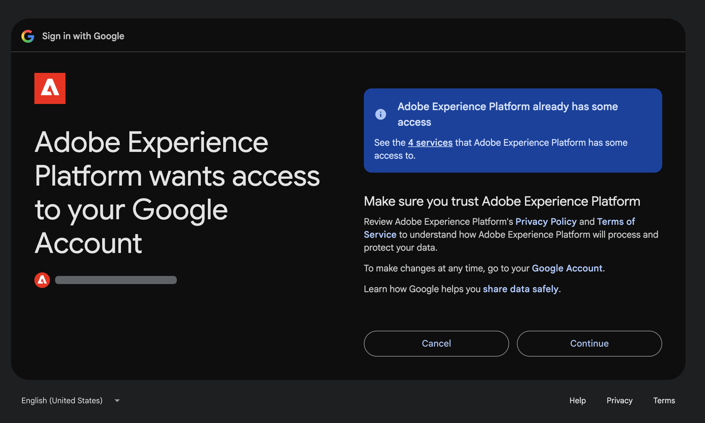

# Connettore esterno Google Ads {#google-ads}

Utilizza il connettore esterno [!DNL Google Ads] per lavorare con i dati di [!DNL Google Ads] in Adobe CX Enterprise Coworker. Dopo aver configurato il connettore, chiedi a Collaboratore a quali account di annunci puoi accedere, quali campi e metriche sono disponibili e come funzionano le campagne. Il connettore è un server MCP (Model Context Protocol).

>[!AVAILABILITY]
>
>Il connettore esterno [!DNL Google Ads] è in versione beta. La documentazione e le funzionalità sono soggette a modifiche.

## Configurazione del connettore {#connector-configuration}

Il processo di configurazione del connettore è costituito da due parti separate:

* **Configurazione organizzazione:** Un amministratore configura il connettore una sola volta per l&#39;intera organizzazione e seleziona gli strumenti che i membri possono utilizzare. Adobe fornisce l’applicazione OAuth, pertanto non sono presenti credenziali dell’app da immettere.
* **Accesso membro:** Ogni membro effettua l&#39;accesso con il proprio account [!DNL Google]. I membri possono accedere solo agli account [!DNL Google Ads] a cui può accedere l&#39;account [!DNL Google].

Il salvataggio della configurazione dell&#39;organizzazione non comporta l&#39;accesso ai membri o l&#39;accesso agli account [!DNL Google Ads]. Ogni membro deve effettuare l&#39;accesso separatamente.

## Prerequisiti {#prerequisites}

Prima di iniziare, assicurati di disporre dei seguenti elementi:

* **Per la configurazione dell&#39;organizzazione:** un account con l&#39;autorizzazione per gestire i connettori dell&#39;organizzazione in Coworker.
* **Per l&#39;accesso membro:** Un account [!DNL Google] con accesso agli account [!DNL Google Ads] che si intende utilizzare.

## Configurare il connettore per l’organizzazione {#configure-organization}

Gli amministratori rendono il connettore [!DNL Google Ads] disponibile a tutti gli utenti dell&#39;organizzazione. Le modifiche apportate alla pagina dell’organizzazione vengono applicate a tutti gli utenti dell’organizzazione.

1. Apri **[!UICONTROL Personalizzazioni]**, seleziona **[!UICONTROL Organizzazione]**, quindi seleziona **[!UICONTROL Connettori esterni]**. Nella scheda **[!UICONTROL Google Ads]**, seleziona **[!UICONTROL Configura]**.

1. Nella finestra di dialogo **[!UICONTROL Configura Google Ads per l&#39;organizzazione]**, verifica che **[!UICONTROL l&#39;applicazione OAuth]** sia **[!UICONTROL l&#39;applicazione OAuth gestita da Adobe]**. Adobe fornisce l&#39;app [!DNL Google Ads], pertanto non è necessario immettere le credenziali dell&#39;app. In **[!UICONTROL Strumenti disponibili per gli utenti]**, selezionare gli strumenti necessari per l&#39;organizzazione. Per ulteriori informazioni, vedere [Strumenti disponibili](#available-tools). Rivedi **[!UICONTROL Ogni persona effettua l&#39;accesso separatamente]** e seleziona **[!UICONTROL Salva connessione]**.

   {width="500" zoomable="yes"}

1. Rivedi i dettagli del connettore **[!UICONTROL google-ads]** salvato.

   | Impostazione | Descrizione |
   | --- | --- |
   | **[!UICONTROL Source]** | URL del server MCP per l’ambiente in uso. |
   | **[!UICONTROL Authentication]** | Metodo di autenticazione `google-ads_login`. |
   | **[!UICONTROL Criteri dello strumento]** | Nomi di utensili o pattern consentiti. |
   | **[!UICONTROL Connessione]** | Il tuo stato di accesso. |

   {width="700" zoomable="yes"}

Lo stato **[!UICONTROL Connessione]** nei dettagli del connettore fa riferimento alla tua connessione e non all&#39;organizzazione. Ogni membro deve comunque effettuare l&#39;accesso con il proprio account. Dopo l&#39;accesso, i membri possono selezionare **[!UICONTROL Test]** per verificare l&#39;individuazione dello strumento. Per utilizzare il connettore, seguire i passaggi descritti in [Accedi come membro](#sign-in-as-a-member).

Per interrompere l&#39;offerta del connettore all&#39;organizzazione, selezionare **[!UICONTROL Rimuovi]** nella pagina dei dettagli del connettore.

### Strumenti disponibili {#available-tools}

Il connettore [!DNL Google Ads] fornisce i seguenti strumenti:

| Strumento | Descrizione |
| --- | --- |
| `customers_list_accessible_customers` | Elencare gli ID cliente a cui l&#39;account [!DNL Google] connesso può accedere direttamente. |
| `metadata_get_resource_metadata` | Trovare i campi, le metriche e i segmenti utilizzabili per una risorsa [!DNL Google Ads], ad esempio una campagna o un gruppo di annunci. |
| `search_search` | Recupera la configurazione di [!DNL Google Ads] o i dati di reporting. |

## Accedi come membro {#sign-in-as-a-member}

Dopo che un amministratore ha configurato il connettore, ogni membro accede con il proprio account [!DNL Google].

1. Apri **[!UICONTROL Personalizzazioni]**, seleziona **[!UICONTROL Utente]**, quindi seleziona **[!UICONTROL Connettori esterni]**. Nella scheda **[!UICONTROL Google Ads]**, seleziona **[!UICONTROL Accedi]**.

   Se nella scheda è visualizzato **[!UICONTROL Non configurato]** o il connettore non è disponibile, chiedere all&#39;amministratore di [configurare il connettore](#configure-organization).

1. Nella schermata [!DNL Google] **[!UICONTROL Scegli un account]**, seleziona l&#39;account con accesso ai tuoi account [!DNL Google Ads] oppure seleziona **[!UICONTROL Usa un altro account]**. Completa quindi tutti i passaggi di accesso richiesti dalla tua organizzazione, ad esempio Single Sign-On (SSO), autenticazione a più fattori (MFA) o verifica dell’identità.

   I passaggi e il relativo ordine dipendono dall’organizzazione e dai criteri dell’account.

   {width="500" zoomable="yes"}

1. Rivedi l&#39;account selezionato e l&#39;app che stai autorizzando, quindi seleziona **[!UICONTROL Continua]**.

   [!DNL Google] mostra il nome app come [!DNL Adobe Experience Platform]. Se l&#39;app è stata utilizzata in precedenza, [!DNL Google] indica che si sta effettuando nuovamente l&#39;accesso. Gli utenti alle prime esperienze potrebbero visualizzare prompt diversi.

   {width="500" zoomable="yes"}

1. Rivedi la richiesta di accesso, quindi seleziona **[!UICONTROL Continua]**.

   {width="500" zoomable="yes"}

   >[!IMPORTANT]
   >
   >Continua solo se riconosci l’app e l’organizzazione approva l’accesso richiesto.

1. Dopo che [!DNL Google] ti ha restituito a Coworker, apri i dettagli del connettore **[!UICONTROL google-ads]**. Verificare che nel connettore sia visualizzato **[!UICONTROL Connesso]** e **[!UICONTROL Accesso effettuato]**.

   Mantieni l&#39;**[!UICONTROL identificatore risorsa]** al valore predefinito, a meno che l&#39;amministratore non ti dica diversamente. Questo campo imposta il pubblico del token inviato al momento dell&#39;accesso. Per tornare all&#39;impostazione predefinita, cancellare il campo e selezionare **[!UICONTROL Salva identificatore risorsa]**.

   {width="700" zoomable="yes"}

1. Seleziona **[!UICONTROL Test]** per verificare che Coworker possa individuare gli strumenti del connettore. Quindi controlla **[!UICONTROL Strumenti abilitati dall&#39;amministratore]** per visualizzare gli strumenti che puoi utilizzare.

   **[!UICONTROL Test]** è disponibile dopo l&#39;accesso.

   {width="700" zoomable="yes"}

Per disconnettere l&#39;account [!DNL Google] dal connettore, selezionare **[!UICONTROL Esci]**. I dettagli del connettore mostrano anche l&#39;impostazione **[!UICONTROL Tool Timeout]** e un controllo **[!UICONTROL Refresh]**.

Lo stato **[!UICONTROL Connesso]** non conferma l&#39;accesso a un account annuncio specifico o che ogni report viene eseguito correttamente. Per confermare l&#39;accesso, [verifica l&#39;accesso all&#39;account dell&#39;annuncio](#check-ad-account-access).

## Verifica l’accesso all’account dell’annuncio {#check-ad-account-access}

Per confermare quali account [!DNL Google Ads] puoi utilizzare, avvia una chat e immetti un prompt.

Esempio di prompt:

* &quot;A quali account Google Ads posso accedere?&quot;

Collaboratore utilizza lo strumento `customers_list_accessible_customers` per elencare gli ID cliente a cui il tuo account [!DNL Google] può accedere direttamente. Si tratta di un controllo di accesso all&#39;account, non di un rapporto sulle prestazioni. Se utilizzi un account manager, l’elenco non include tutti gli account al suo interno.

Prima di richiedere un rapporto, effettuare le seguenti operazioni:

* Scegli un account dall’elenco.
* Specifica un intervallo di date con una data di inizio e una data di fine.
* Chiedi a Collaboratore di trovare i campi e le metriche disponibili per il rapporto.

## Risolvere i problemi di accesso {#troubleshoot-access}

Se non riesci ad accedere ai dati di [!DNL Google Ads], verifica quanto segue con il tuo amministratore:

| Area | Cosa controllare |
| --- | --- |
| Account [!DNL Google] | Hai effettuato l&#39;accesso con l&#39;account [!DNL Google] che ha accesso all&#39;account [!DNL Google Ads]. |
| Autorizzazioni account | L&#39;account [!DNL Google] dispone delle autorizzazioni per gli account [!DNL Google Ads] che si desidera utilizzare. |
| Account manager | Se accedi a un account tramite un account manager, l’amministratore ha confermato la configurazione dell’account manager richiesta. |
| Selezione dello strumento | L&#39;amministratore ha abilitato gli strumenti necessari in **[!UICONTROL Strumenti disponibili per gli utenti]**. |
| Identificatore risorsa | L&#39;**[!UICONTROL identificatore risorsa]** utilizza il valore predefinito, a meno che l&#39;amministratore non indichi diversamente. |
