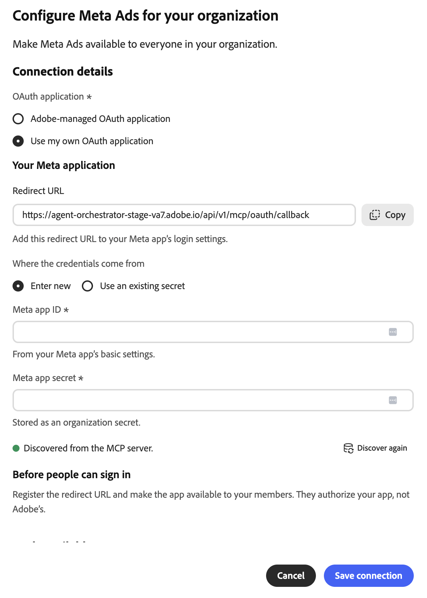

# Connettore esterno Meta Ads {#meta-ads}

Utilizza il connettore esterno [!DNL Meta Ads] per lavorare con i dati pubblicitari di [!DNL Meta] in Adobe CX Enterprise Coworker. Dopo aver configurato il connettore, chiedi a Collaboratore di generare rapporti sulle prestazioni degli annunci, gestire campagne e tipi di pubblico, lavorare con i cataloghi di prodotti e altro ancora. Il connettore è un server MCP ospitato da [!DNL Meta].

>[!AVAILABILITY]
>
>Il connettore esterno [!DNL Meta Ads] è in versione beta. La documentazione e le funzionalità sono soggette a modifiche.

## Configurazione del connettore {#connector-configuration}

Il processo di configurazione del connettore è costituito da due parti separate:

* **Configurazione organizzazione:** Un amministratore configura il connettore una sola volta per l&#39;intera organizzazione. L&#39;amministratore sceglie l&#39;applicazione OAuth e seleziona gli strumenti che i membri possono utilizzare.
* **Accesso membro:** Ogni membro effettua l&#39;accesso con il proprio account [!DNL Facebook]. I membri possono accedere solo alle risorse [!DNL Meta] consentite dall&#39;identità [!DNL Facebook] e dall&#39;app autorizzata.

Il salvataggio della configurazione dell’organizzazione non comporta l’accesso ad alcun membro né l’accesso ad account pubblicitari. Ogni membro deve effettuare l&#39;accesso separatamente.

## Prerequisiti {#prerequisites}

Prima di iniziare, assicurati di disporre dei seguenti elementi:

* **Per la configurazione dell&#39;organizzazione:** un account con l&#39;autorizzazione per gestire i connettori dell&#39;organizzazione in Coworker.
* **Per l&#39;accesso dei membri:** Un account [!DNL Facebook] con accesso agli account degli annunci, alle aziende, alle pagine o ad altre risorse [!DNL Meta] che intendi utilizzare.
* **Per la tua app OAuth (facoltativo):** app [!DNL Meta] gestita dalla tua organizzazione, insieme al relativo ID app e segreto app.

## Configurare il connettore per l’organizzazione {#configure-organization}

Gli amministratori rendono il connettore [!DNL Meta Ads] disponibile a tutti gli utenti dell&#39;organizzazione. Le modifiche apportate alla pagina dell’organizzazione vengono applicate a tutti gli utenti dell’organizzazione.

1. Apri **[!UICONTROL Personalizzazioni]**, seleziona **[!UICONTROL Organizzazione]**, quindi seleziona **[!UICONTROL Connettori esterni]**. Nella scheda **[!UICONTROL Meta Ads]**, seleziona **[!UICONTROL Configura]**.

1. Nella finestra di dialogo **[!UICONTROL Configura Meta Ads per l&#39;organizzazione]**, controlla **[!UICONTROL Dettagli connessione]**, quindi seleziona un&#39;applicazione **[!UICONTROL OAuth]**:

   * **[!UICONTROL Applicazione OAuth gestita da Adobe]:** Adobe fornisce l&#39;app [!DNL Meta Ads], pertanto non è necessario immettere le credenziali dell&#39;app. Ogni membro continua ad accedere con il proprio account [!DNL Facebook] dopo il salvataggio.

     {width="500" zoomable="yes"}

   * **[!UICONTROL Utilizza la mia applicazione OAuth]:** La tua organizzazione fornisce la propria app [!DNL Meta]. I membri autorizzano la tua app, non l’app Adobe. In **[!UICONTROL La tua applicazione Meta]**, completa i seguenti passaggi:

     1. Copia l&#39;**[!UICONTROL URL di reindirizzamento]** e aggiungilo alle impostazioni di accesso dell&#39;app [!DNL Meta]. Utilizza il valore esatto mostrato nella finestra di dialogo, perché l’URL di reindirizzamento varia da un ambiente all’altro.
     1. In **[!UICONTROL Da cui provengono le credenziali]**, selezionare **[!UICONTROL Immetti nuovo]**, quindi immettere l&#39;**[!UICONTROL ID app Meta]** e il **[!UICONTROL segreto app Meta]**. Trovare l&#39;ID app nelle impostazioni di base dell&#39;app [!DNL Meta]. Il segreto dell’app viene memorizzato come segreto dell’organizzazione. Per riutilizzare le credenziali salvate per la stessa app, selezionare **[!UICONTROL Usa un segreto esistente]**.
     1. Rendi l&#39;app disponibile ai membri che effettueranno l&#39;accesso. Chiedi all&#39;amministratore dell&#39;app [!DNL Meta] di confermare le autorizzazioni necessarie e tutti i requisiti di revisione dell&#39;app per l&#39;uso previsto.

     L&#39;indicatore **[!UICONTROL Rilevato dal server MCP]** conferma che il connettore è stato trovato. Non conferma che le credenziali dell&#39;app siano valide o che i membri abbiano effettuato l&#39;accesso. Per aggiornare l&#39;individuazione, selezionare **[!UICONTROL Rileva di nuovo]**.

     {width="500" zoomable="yes"}

1. In **[!UICONTROL Strumenti disponibili per gli utenti]**, espandi ogni gruppo di strumenti e seleziona gli strumenti necessari per la tua organizzazione. Per modificare tutti gli strumenti contemporaneamente, utilizzare **[!UICONTROL Seleziona tutto]** o **[!UICONTROL Cancella tutto]**. Per ulteriori informazioni, vedere [Gruppi di strumenti](#tool-groups). Quindi seleziona **[!UICONTROL Salva connessione]**.

   {width="500" zoomable="yes"}

1. Rivedi i dettagli del connettore **[!UICONTROL meta-ads]** salvato. Facoltativamente, selezionare **[!UICONTROL Test]** per verificare che sia possibile individuare gli strumenti del connettore.

   | Impostazione | Descrizione |
   | --- | --- |
   | **[!UICONTROL Source]** | Server MCP [!DNL Meta Ads], `https://mcp.facebook.com/ads`. |
   | **[!UICONTROL Authentication]** | Metodo di autenticazione `meta-ads_login`. |
   | **[!UICONTROL Connessione]** | L’applicazione OAuth in uso e il tuo stato di accesso. |
   | **[!UICONTROL Strumenti]** | Strumenti selezionati per i membri, con **[!UICONTROL Seleziona tutti]** e **[!UICONTROL Cancella]** controlli e un conteggio degli strumenti selezionati. |

   {width="700" zoomable="yes"}

Lo stato **[!UICONTROL Non connesso]** nei dettagli del connettore fa riferimento alla tua connessione e non all&#39;organizzazione. Per utilizzare il connettore, seleziona **[!UICONTROL Accedi]** e segui i passaggi descritti in [Accedi come membro](#sign-in-as-a-member).

Per interrompere l&#39;offerta del connettore all&#39;organizzazione, selezionare **[!UICONTROL Rimuovi]** nella pagina dei dettagli del connettore.

### Gruppi di strumenti {#tool-groups}

Il connettore [!DNL Meta Ads] organizza i propri strumenti nei seguenti gruppi:

* [!UICONTROL Reporting e approfondimenti]
* [!UICONTROL Annunci, campagne e pubblico]
* [!UICONTROL Cataloghi e prodotti]
* [!UICONTROL Segnali e set di dati]
* [!UICONTROL Test A/B e studi di incremento]
* [!UICONTROL Registri attività]
* [!UICONTROL Guida e risoluzione dei problemi]

Ad esempio, il gruppo [!UICONTROL Reporting and Insights] include strumenti come `ads_insights_performance_trend` e `ads_insights_industry_benchmark`. Gli strumenti in ogni gruppo possono cambiare quando [!DNL Meta] aggiorna il connettore.

>[!IMPORTANT]
>
>Non tutti gli strumenti sono di sola lettura. Alcuni strumenti possono modificare campagne, budget, tipi di pubblico, cataloghi o altre risorse pubblicitarie. Seleziona solo gli strumenti che i membri dell’organizzazione intendono utilizzare.

Dopo il salvataggio, gli strumenti non selezionati non saranno disponibili per i membri finché non vengono selezionati. Per verificare quali strumenti possono essere utilizzati dai membri, esaminare la sezione **[!UICONTROL Strumenti disponibili]** nella pagina dei dettagli del connettore.

## Accedi come membro {#sign-in-as-a-member}

Dopo che un amministratore ha configurato il connettore, ogni membro accede con il proprio account [!DNL Facebook]. Non è necessario un segreto app o un token di accesso per accedere.

1. Apri **[!UICONTROL Personalizzazioni]**, seleziona **[!UICONTROL Utente]**, quindi seleziona **[!UICONTROL Connettori esterni]**.

1. Nella scheda **[!UICONTROL Meta Ads]**, seleziona **[!UICONTROL Accedi]**.

   Se nella scheda è visualizzato **[!UICONTROL Non configurato]** o il connettore non è disponibile, chiedere all&#39;amministratore di [configurare il connettore](#configure-organization).

1. Accedere a [!DNL Facebook] e completare le richieste necessarie, ad esempio Single Sign-On (SSO), Multi-Factor Authentication (MFA), Consenso o Verifica identità.

   L’ordine di queste richieste dipende dai criteri dell’account e dell’organizzazione. Gli utenti alle prime esperienze possono visualizzare anche le richieste di concessione delle autorizzazioni e di selezione delle risorse.

1. Esaminare l&#39;account [!DNL Facebook] e l&#39;app che si sta autorizzando, quindi eseguire una delle operazioni seguenti:

   * Per mantenere le impostazioni precedenti, selezionare **[!UICONTROL Continua]**.
   * Per rivedere o modificare l&#39;autorizzazione, selezionare **[!UICONTROL Modifica impostazioni]**.
   * Per utilizzare un account [!DNL Facebook] diverso, selezionare **[!UICONTROL Accedi a un altro account]**.

   Con l&#39;app gestita da Adobe, autorizzi [!DNL Adobe Experience Cloud]. Nell’app della tua organizzazione, il nome dell’app e i prompt sono diversi.

   {width="400" zoomable="yes"}

   >[!IMPORTANT]
   >
   >L&#39;app riceve l&#39;accesso continuo alle informazioni condivise e [!DNL Meta] record quando l&#39;app accede a tali informazioni. Continua solo se l’organizzazione approva l’accesso richiesto.

1. Dopo che [!DNL Facebook] ti ha restituito a Coworker, apri i dettagli del connettore **[!UICONTROL meta-ads]**. Verificare che nel connettore sia visualizzato **[!UICONTROL Connesso]** e **[!UICONTROL Accesso effettuato]**.

   {width="700" zoomable="yes"}

1. Rivedi **[!UICONTROL Strumenti abilitati dall&#39;amministratore]** per visualizzare gli strumenti che puoi utilizzare.

I dettagli del connettore mostrano anche l&#39;impostazione **[!UICONTROL Timeout strumento]** e i seguenti controlli:

* **[!UICONTROL Ricarica strumenti]:** Aggiorna l&#39;elenco degli strumenti.
* **[!UICONTROL Test]:** Verificare che Coworker possa individuare gli strumenti del connettore.
* **[!UICONTROL Disconnetti]:** Disconnetti l&#39;account [!DNL Facebook] dal connettore.

Uno stato di **[!UICONTROL Connesso]** non conferma l&#39;accesso a un account annuncio specifico o che ogni strumento è stato eseguito correttamente. Per confermare l&#39;accesso, [verifica l&#39;accesso all&#39;account dell&#39;annuncio](#check-ad-account-access).

## Verifica l’accesso all’account dell’annuncio {#check-ad-account-access}

Per confermare quali account annuncio puoi utilizzare, avvia una chat e immetti un prompt di sola lettura.

Esempio di prompt:

* &quot;A quali account Meta Ad posso accedere? Mettili in vendita senza cambiare nulla.&quot;

Se l&#39;amministratore ha attivato lo strumento `ads_get_ad_accounts`, in Collaboratore verranno elencati gli account pubblicitari a cui è possibile accedere. Per ogni account, Collaboratore mostra l’azienda proprietaria, l’idoneità MCP e la disponibilità di reporting. Scegli un account accessibile prima di richiedere rapporti o eseguire azioni.

## Risolvere i problemi di accesso {#troubleshoot-access}

Se non riesci ad accedere alle risorse [!DNL Meta], verifica quanto segue:

| Area | Cosa controllare |
| --- | --- |
| Account [!DNL Facebook] | Hai effettuato l&#39;accesso con l&#39;account [!DNL Facebook] che ha accesso all&#39;account annuncio. |
| Autorizzazioni risorsa | L&#39;account [!DNL Facebook] dispone delle autorizzazioni per gli account degli annunci, le aziende o le pagine che si desidera utilizzare. |
| Autorizzazione app | Hai autorizzato l’app e hai condiviso le risorse richieste. Per rivedere l&#39;autorizzazione, disconnettersi e accedere di nuovo, quindi selezionare **[!UICONTROL Modifica impostazioni]**. |
| Strumenti abilitati | L&#39;amministratore ha abilitato gli strumenti necessari in **[!UICONTROL Strumenti disponibili per gli utenti]**. |
| La tua app OAuth | L&#39;URL di reindirizzamento corrisponde esattamente, l&#39;ID app e il segreto dell&#39;app sono corretti e i membri hanno accesso all&#39;app. Conferma le autorizzazioni necessarie con l&#39;amministratore dell&#39;app [!DNL Meta]. |
