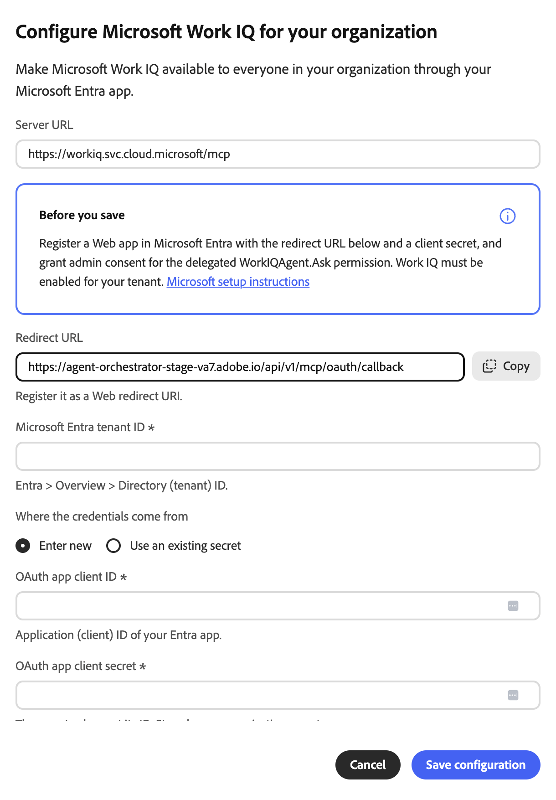

# Connettore esterno Microsoft Work IQ {#microsoft-work-iq}

Utilizza il connettore esterno [!DNL Microsoft Work IQ] per lavorare con i dati di [!DNL Microsoft 365] in Adobe CX Enterprise Coworker. Dopo aver configurato il connettore, chiedere a Collaboratore di eseguire ricerche nelle e-mail, nei file, nelle riunioni e nei [!DNL Microsoft Teams] messaggi, esaminare gli eventi del calendario e altro ancora. Il connettore è un server MCP ospitato da [!DNL Microsoft].

>[!AVAILABILITY]
>
>Il connettore esterno [!DNL Microsoft Work IQ] è in versione beta. La documentazione e le funzionalità sono soggette a modifiche.

## Configurazione del connettore {#connector-configuration}

Il processo di configurazione del connettore è costituito da due parti separate:

* **Configurazione organizzazione:** Un amministratore configura il connettore una sola volta per l&#39;intera organizzazione. L&#39;amministratore connette un&#39;app [!DNL Microsoft Entra] e seleziona gli strumenti che i membri possono utilizzare.
* **Accesso membro:** Ogni membro accede con il proprio account di lavoro [!DNL Microsoft]. I membri possono accedere solo ai dati a cui può accedere il proprio account.

Il salvataggio della configurazione dell&#39;organizzazione non comporta l&#39;accesso ad alcun membro né la concessione di ulteriori autorizzazioni [!DNL Microsoft 365]. Ogni membro deve effettuare l&#39;accesso separatamente.

La scheda **[!UICONTROL Microsoft Work IQ]** fa riferimento a un&#39;app OAuth condivisa, disponibile solo quando la distribuzione ne configura una. Non presumere che sia già stata fornita un’app. In questa pagina viene descritto come connettere la propria app [!DNL Microsoft Entra].

## Prerequisiti {#prerequisites}

Prima di iniziare, assicurati di disporre dei seguenti elementi:

* **Per la configurazione dell&#39;organizzazione:** un account con l&#39;autorizzazione per gestire i connettori dell&#39;organizzazione in Coworker.
* **Per l&#39;app [!DNL Microsoft Entra]:** Un amministratore [!DNL Microsoft Entra] che può registrare un&#39;app Web e concedere il consenso dell&#39;amministratore.
* **Per il tenant [!DNL Microsoft]:** [!DNL Work IQ] abilitato per il tenant.
* **Per l&#39;accesso membro:** Un account di lavoro [!DNL Microsoft] idoneo con accesso ai dati che si intende utilizzare.

## Configurare il connettore per l’organizzazione {#configure-organization}

Gli amministratori rendono il connettore [!DNL Microsoft Work IQ] disponibile a tutti gli utenti dell&#39;organizzazione. Le modifiche apportate alla pagina dell’organizzazione vengono applicate a tutti gli utenti dell’organizzazione.

1. Apri **[!UICONTROL Personalizzazioni]**, seleziona **[!UICONTROL Organizzazione]**, quindi seleziona **[!UICONTROL Connettori esterni]**. Nella scheda **[!UICONTROL Microsoft Work IQ]**, seleziona **[!UICONTROL Configura]**.

1. Nella finestra di dialogo **[!UICONTROL Configura Microsoft Work IQ per la tua organizzazione]**, controlla **[!UICONTROL URL server]**, `https://workiq.svc.cloud.microsoft/mcp`. Quindi prepara l&#39;app [!DNL Microsoft Entra]. Per i requisiti di [!DNL Microsoft], selezionare **[!UICONTROL Istruzioni di installazione di Microsoft]** nella finestra di dialogo.

   1. Registrare un&#39;app Web in [!DNL Microsoft Entra] o utilizzarne una esistente.
   1. Copia l&#39;**[!UICONTROL URL di reindirizzamento]** dalla finestra di dialogo e registra questo valore esatto come URI di reindirizzamento Web nell&#39;app. L’URL di reindirizzamento varia da un ambiente all’altro, quindi copialo sempre dalla finestra di dialogo.
   1. Crea un segreto client o verifica che il segreto client esistente sia ancora valido. È necessario il valore segreto, non l’ID segreto.
   1. Concedere il consenso dell&#39;amministratore per l&#39;autorizzazione delegata `WorkIQAgent.Ask` e confermare che [!DNL Work IQ] è abilitato per il tenant.

   In **[!UICONTROL ID tenant Microsoft Entra]**, immetti l&#39;ID tenant. In [!DNL Microsoft Entra], trovare questo valore in **[!UICONTROL Panoramica]** > **[!UICONTROL Directory (tenant) ID]**.

   {width="500" zoomable="yes"}

1. In **[!UICONTROL Da cui provengono le credenziali]**, selezionare una delle opzioni seguenti:

   * **[!UICONTROL Immetti nuovo]:** In **[!UICONTROL ID client app OAuth]**, immetti l&#39;ID applicazione (client) dell&#39;app [!DNL Microsoft Entra]. In **[!UICONTROL Segreto client app OAuth]**, immettere il valore segreto. Il valore segreto viene memorizzato come segreto dell’organizzazione.
   * **[!UICONTROL Usa un segreto esistente]:** In **[!UICONTROL Segreto contenente l&#39;ID client]** e **[!UICONTROL Segreto contenente il segreto client]**, seleziona i segreti organizzazione salvati per l&#39;app. Se i segreti corretti non sono disponibili, selezionare **[!UICONTROL Immetti nuovo]**. Puoi comunque immettere l’ID tenant separatamente.

   L’ID tenant, l’ID client e il segreto client devono appartenere tutti alla stessa app e allo stesso tenant. Se riutilizzi i segreti salvati, verifica che il segreto client non sia scaduto. Queste credenziali dell&#39;app sono separate dalle password [!DNL Microsoft] utilizzate dai membri per accedere.

   {width="500" zoomable="yes"}

1. In **[!UICONTROL Strumenti disponibili per gli utenti]**, selezionare gli strumenti necessari per l&#39;organizzazione. Per ulteriori informazioni, vedere [Strumenti disponibili](#available-tools). Rivedi **[!UICONTROL Accesso e autorizzazioni]**, che conferma che ogni persona effettua l&#39;accesso separatamente, quindi seleziona **[!UICONTROL Salva configurazione]**.

   {zoomable="yes"}

1. Rivedi i dettagli del connettore **[!UICONTROL workiq]** salvato. Facoltativamente, selezionare **[!UICONTROL Test]** per verificare che sia possibile individuare gli strumenti del connettore. Per modificare gli strumenti dopo il salvataggio, vedere [Modificare la selezione dello strumento](#change-tool-selection).

   | Impostazione | Descrizione |
   | --- | --- |
   | **[!UICONTROL Source]** | Server MCP [!DNL Work IQ], `https://workiq.svc.cloud.microsoft/mcp`. |
   | **[!UICONTROL Authentication]** | Metodo di autenticazione `workiq_login`. |
   | **[!UICONTROL Timeout strumento]** | Timeout dello strumento per il connettore. |
   | **[!UICONTROL Connessione]** | Il tuo stato di accesso. |

   {width="500" zoomable="yes"}

Lo stato **[!UICONTROL Non connesso]** nei dettagli del connettore fa riferimento alla tua connessione e non all&#39;organizzazione. Per utilizzare il connettore, seleziona **[!UICONTROL Accedi]** e segui i passaggi descritti in [Accedi come membro](#sign-in-as-a-member).

Per interrompere l&#39;offerta del connettore all&#39;organizzazione, selezionare **[!UICONTROL Rimuovi]** nella pagina dei dettagli del connettore.

### Strumenti disponibili {#available-tools}

Il connettore [!DNL Microsoft Work IQ] fornisce i seguenti strumenti:

| Strumento | Descrizione |
| --- | --- |
| `search_paths` | Scopri le funzionalità di [!DNL Microsoft 365] disponibili e come gestirle. |
| `get_schema` | Visualizza i campi accettati o restituiti da una richiesta supportata. |
| `list_agents` | Visualizza gli agenti [!DNL Microsoft 365 Copilot] disponibili per il tuo account, senza eseguirli. |
| `fetch` | Leggi [!DNL Microsoft 365] elementi a cui il tuo account può accedere, ad esempio messaggi, eventi, file e persone. Non modifica i dati. |
| `call_function` | Calcola i risultati dai dati a cui il tuo account può accedere, ad esempio una visualizzazione calendario o modifiche recenti. Non modifica i dati. |
| `retrieve` | Cerca nei tuoi messaggi di posta elettronica, file, riunioni, [!DNL Microsoft Teams] messaggi, persone e origini connesse, con collegamenti a ogni origine. |
| `fetch_blob` | Scaricare un file, ad esempio un documento, un&#39;immagine o una foto di profilo, fino a 4 MB. Non modifica i dati. |
| `ask` | Chiedi a [!DNL Microsoft 365 Copilot] o a uno dei suoi agenti informazioni su e-mail, riunioni, file e altri dati di [!DNL Microsoft 365]. |
| `delete_entity` | Eliminare un elemento [!DNL Microsoft 365], ad esempio un messaggio o un evento. Modifica i dati. |
| `do_action` | Eseguire un&#39;azione [!DNL Microsoft 365], ad esempio inviare posta o spostare un elemento. Modifica i dati. |
| `create_entity` | Creare un elemento [!DNL Microsoft 365], ad esempio un evento o una bozza di messaggio. Modifica i dati. |
| `update_entity` | Modifica un elemento [!DNL Microsoft 365] esistente, ad esempio un evento o un contatto. Modifica i dati. |

>[!IMPORTANT]
>
>Gli strumenti `delete_entity`, `do_action`, `create_entity` e `update_entity` modificano i dati in [!DNL Microsoft 365]. Esamina attentamente questi strumenti e seleziona solo gli strumenti che i membri dell’organizzazione intendono utilizzare.

Gli strumenti aggiunti in seguito dal server rimangono disattivati fino a quando non vengono selezionati.

### Modificare la selezione dell&#39;utensile {#change-tool-selection}

Per modificare gli strumenti disponibili per i membri dopo il salvataggio, utilizzare la sezione **[!UICONTROL Strumenti]** nella pagina dei dettagli del connettore.

1. Selezionare o cancellare i singoli strumenti oppure utilizzare **[!UICONTROL Seleziona tutto]** o **[!UICONTROL Cancella]**.

1. Selezionare **[!UICONTROL Salva selezione strumenti]**.

>[!CAUTION]
>
>Selezionando **[!UICONTROL Mostra ogni strumento]** si cancella la selezione corrente. I membri possono quindi utilizzare tutti gli strumenti che il criterio non esclude, fino a quando non si salva una nuova selezione. Non selezionare **[!UICONTROL Mostra tutti gli strumenti]** solo per visualizzare l&#39;elenco degli strumenti.

## Accedi come membro {#sign-in-as-a-member}

Dopo che un amministratore ha configurato il connettore, ogni membro accede con il proprio account di lavoro [!DNL Microsoft]. Non è necessario il segreto del client dell&#39;app per accedere.

1. Apri **[!UICONTROL Personalizzazioni]**, seleziona **[!UICONTROL Utente]**, quindi seleziona **[!UICONTROL Connettori esterni]**.

1. Nella scheda **[!UICONTROL Microsoft Work IQ]**, seleziona **[!UICONTROL Accedi]**.

   Se nella scheda è visualizzato **[!UICONTROL Non configurato]** o il connettore non è disponibile, chiedere all&#39;amministratore di [configurare il connettore](#configure-organization).

1. Nella schermata [!DNL Microsoft] **[!UICONTROL Scegli un account]**, seleziona l&#39;account di lavoro per la tua organizzazione oppure seleziona **[!UICONTROL Usa un altro account]**.

   Il browser potrebbe ricordare diversi account, inclusi quelli di altri tenant. L&#39;account già connesso non è sempre quello corretto. Scegli l&#39;account con l&#39;accesso [!DNL Microsoft 365] necessario.

   {width="400" zoomable="yes"}

1. Completa i passaggi di accesso per il tuo account, ad esempio password, Single Sign-On (SSO), accesso senza password, autenticazione a più fattori (MFA) o altra verifica.

   Immetti le credenziali di [!DNL Microsoft] solo nel flusso di accesso approvato dalla tua organizzazione. Non inserirle mai nei campi app OAuth del connettore.

   {width="400" zoomable="yes"}

1. Se [!DNL Microsoft] richiede il consenso, rivedere la richiesta.

   >[!IMPORTANT]
   >
   >Continua solo se riconosci l’app e l’organizzazione approva l’accesso richiesto.

1. Dopo che [!DNL Microsoft] ti ha restituito a Coworker, apri i dettagli del connettore **[!UICONTROL workiq]**. Verificare che nel connettore sia visualizzato **[!UICONTROL Connesso]** e **[!UICONTROL Accesso effettuato]**.

   {width="700" zoomable="yes"}

1. Rivedi **[!UICONTROL Strumenti abilitati dall&#39;amministratore]** per visualizzare gli strumenti che puoi utilizzare.

Dai dettagli del connettore, puoi anche eseguire le seguenti operazioni:

* **[!UICONTROL Test]:** Verificare che Coworker possa individuare gli strumenti del connettore.
* **[!UICONTROL Disconnetti]:** Disconnetti l&#39;account [!DNL Microsoft] dal connettore.

I dettagli del connettore mostrano anche l&#39;impostazione **[!UICONTROL Tool Timeout]** e un controllo **[!UICONTROL Refresh]**.

Lo stato di **[!UICONTROL Connesso]** non conferma che è possibile accedere a ogni risorsa [!DNL Microsoft 365] o che ogni strumento è stato eseguito correttamente. Per confermare l&#39;accesso, [verifica l&#39;accesso a Microsoft 365](#check-access).

## Controlla l&#39;accesso a Microsoft 365 {#check-access}

Per confermare che il connettore possa leggere i dati, avvia una chat e immetti un prompt di sola lettura.

Esempio di prompt:

* &quot;Trovate le mie riunioni per domani e includete i link alle fonti. Non creare, aggiornare, inviare o eliminare nulla.&quot;

Affinché la richiesta funzioni, l&#39;amministratore deve attivare uno strumento in grado di leggere i dati del calendario e l&#39;account deve avere accesso ai dati.

## Risolvere i problemi di accesso {#troubleshoot-access}

Se l&#39;accesso o l&#39;accesso non riesce, verifica quanto segue con il tuo amministratore:

| Area | Cosa controllare |
| --- | --- |
| Account [!DNL Microsoft] | Hai effettuato l’accesso con l’account di lavoro corretto per il tenant previsto. |
| Disponibilità di [!DNL Work IQ] | [!DNL Work IQ] è abilitato per il tenant [!DNL Microsoft]. |
| URI di reindirizzamento | L&#39;app [!DNL Microsoft Entra] dispone dell&#39;URL di reindirizzamento esatto dalla finestra di dialogo registrata come URI di reindirizzamento Web. |
| Consenso dell’amministratore | Un amministratore ha concesso il consenso dell&#39;amministratore per l&#39;autorizzazione delegata `WorkIQAgent.Ask`. |
| Segreto client | Il segreto client non è scaduto e il connettore utilizza il valore segreto, non l’ID segreto. |
| Segreti salvati | Entrambi i segreti organizzazione selezionati appartengono all&#39;app [!DNL Microsoft Entra] prevista. |
| Selezione dello strumento | In caso di guasto di un solo strumento, l’amministratore ha attivato tale strumento. |
| Autorizzazioni [!DNL Microsoft 365] | Il tuo account dispone delle autorizzazioni necessarie per accedere ai dati richiesti. |
