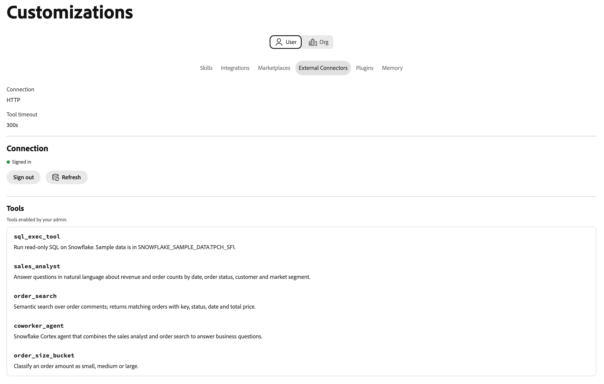

# Connettore esterno Snowflake Cortex AI {#snowflake}

Utilizza il connettore esterno [!DNL Snowflake Cortex AI] per porre domande sui dati di [!DNL Snowflake] in linguaggio semplice in Adobe CX Enterprise Coworker. Il connettore collega Coworker a un server MCP (Model Context Protocol) gestito da [!DNL Snowflake] nell&#39;account [!DNL Snowflake]. Coworker può quindi utilizzare gli strumenti esposti dal server, ad esempio [!DNL Cortex Analyst], [!DNL Cortex Search] e gli strumenti SQL.

>[!AVAILABILITY]
>
>Il connettore esterno [!DNL Snowflake Cortex AI] è in versione beta. La documentazione e le funzionalità sono soggette a modifiche.

## Configurazione del connettore {#connector-configuration}

Il processo di configurazione del connettore è costituito da due parti separate:

* **Configurazione organizzazione:** Un amministratore connette il collaboratore a un server MCP [!DNL Snowflake] esistente, sceglie il modo in cui gli utenti accedono e seleziona gli strumenti che i membri possono utilizzare.
* **Accesso membri:** I membri utilizzano la connessione con un&#39;identità dell&#39;organizzazione condivisa o con una propria identità [!DNL Snowflake], a seconda dell&#39;opzione di accesso.

L&#39;amministratore sceglie una delle seguenti opzioni di accesso:

| Opzione | Informazioni fornite dall&#39;amministratore | Funzionamento dell’accesso |
| --- | --- | --- |
| **[!UICONTROL Account del servizio organizzazione]** | Un token di accesso programmatico (PAT) [!DNL Snowflake] per un account di servizio. | Tutti i membri utilizzano le autorizzazioni dell&#39;account del servizio. La scadenza o la revoca del token interessa tutti i membri. |
| **[!UICONTROL Ogni persona firma in]** | L&#39;ID client e il segreto client di un&#39;integrazione OAuth [!DNL Snowflake] e un ruolo [!DNL Snowflake] facoltativo. | Ogni membro accede con la propria identità [!DNL Snowflake] e l&#39;accesso segue le proprie autorizzazioni [!DNL Snowflake]. |

Nessuna delle due opzioni concede a [!DNL Snowflake] i privilegi che l&#39;identità selezionata non ha già. [!DNL Snowflake] applica le autorizzazioni a ogni richiesta.

## Prerequisiti {#prerequisites}

Collaboratore si connette a un server MCP [!DNL Snowflake] esistente. Non crea il server o i relativi strumenti. Prima di iniziare, assicurati di disporre dei seguenti elementi:

* **Per la configurazione dell&#39;organizzazione:** un account con l&#39;autorizzazione per gestire i connettori dell&#39;organizzazione in Coworker.
* **Per il server MCP [!DNL Snowflake]:** URL HTTPS completo del server, inclusi database, schema e nome server.
* **Per l&#39;opzione dell&#39;account di servizio:** un PAT per un account di servizio dedicato. Il ruolo dell&#39;account del servizio deve disporre solo dei privilegi necessari per il server MCP e i relativi strumenti.
* **Per l&#39;opzione di accesso per persona:** Un&#39;integrazione OAuth [!DNL Snowflake] con l&#39;ID client e il segreto client. È inoltre necessario un amministratore [!DNL Snowflake] che possa registrare l&#39;URL di reindirizzamento di Coworker e configurare l&#39;integrazione.

>[!IMPORTANT]
>
>Non condividere mai PAT, segreti del client OAuth o altre credenziali in screenshot, chat o ticket di supporto. Utilizzare i segreti dell&#39;organizzazione e un&#39;identità [!DNL Snowflake] con privilegi minimi.

### Configurare il server Snowflake MCP {#configure-snowflake-mcp-server}

Un amministratore [!DNL Snowflake] deve completare le seguenti attività in [!DNL Snowflake] prima di configurare il connettore:

1. Crea il server MCP e definisci gli strumenti esposti.
1. Concedi ai ruoli richiesti l’accesso al server MCP, ai relativi strumenti e agli oggetti sottostanti.

   L&#39;accesso al server MCP non concede automaticamente l&#39;accesso a ogni strumento o oggetto.

1. Impostare l&#39;autenticazione per l&#39;opzione di accesso che si intende utilizzare:

   * Per l&#39;opzione dell&#39;account di servizio, creare un PAT per l&#39;account di servizio.
   * Per l’opzione di accesso per persona, crea un’integrazione OAuth che genera token di aggiornamento.

Per istruzioni, vedere la seguente documentazione di [!DNL Snowflake]:

* [Server MCP gestito da Snowflake](https://docs.snowflake.com/en/user-guide/snowflake-cortex/cortex-agents-mcp){target="_blank"}
* [Crea server MCP](https://docs.snowflake.com/en/sql-reference/sql/create-mcp-server){target="_blank"}
* [Panoramica sul controllo degli accessi](https://docs.snowflake.com/en/user-guide/security-access-control-overview){target="_blank"}
* [Configurare Snowflake OAuth per client personalizzati](https://docs.snowflake.com/en/user-guide/oauth-custom){target="_blank"}
* [Creare un’integrazione di sicurezza (Snowflake OAuth)](https://docs.snowflake.com/en/sql-reference/sql/create-security-integration-oauth-snowflake){target="_blank"}
* [Utilizzo di token di accesso programmatici per l’autenticazione](https://docs.snowflake.com/en/user-guide/programmatic-access-tokens){target="_blank"}

## Configurare il connettore per l’organizzazione {#configure-organization}

Gli amministratori rendono il connettore [!DNL Snowflake Cortex AI] disponibile a tutti gli utenti dell&#39;organizzazione. Le modifiche apportate alla pagina dell’organizzazione vengono applicate a tutti gli utenti dell’organizzazione.

1. Apri **[!UICONTROL Personalizzazioni]**, seleziona **[!UICONTROL Organizzazione]**, quindi seleziona **[!UICONTROL Connettori esterni]**. Nella scheda **[!UICONTROL Snowflake Cortex AI]**, seleziona **[!UICONTROL Configura]**.

1. Nella finestra di dialogo **[!UICONTROL Connetti Snowflake Cortex AI]**, immetti l&#39;URL completo del server MCP [!DNL Snowflake] in **[!UICONTROL URL server]**. L’URL deve utilizzare HTTPS e seguire questo pattern:

   ```text
   https://<account-host>/api/v2/databases/<database>/schemas/<schema>/mcp-servers/<server-name>
   ```

   Utilizza l&#39;URL esatto per l&#39;account [!DNL Snowflake] e il server MCP. Il nome host dell&#39;account non deve contenere un carattere di sottolineatura, incluso un carattere di sottolineatura codificato (`%5F`). Non includere le credenziali nell’URL. Collaboratore controlla lo schema HTTPS, l’host e il percorso prima di salvare.

1. In **[!UICONTROL Chi effettua l&#39;accesso?]**, selezionare un&#39;opzione di accesso, quindi completare le impostazioni.

   * **[!UICONTROL Account del servizio organizzazione]:** Le richieste utilizzano le autorizzazioni dell&#39;account del servizio tramite un token di accesso programmatico (PAT). Utilizzare questa opzione per l&#39;accesso gestito centralmente. Utilizza un account di servizio dedicato con un ruolo con ambito ristretto, non un account personale.

     {width="500" zoomable="yes"}

     | Impostazione | Descrizione |
     | --- | --- |
     | **[!UICONTROL Token account di servizio]** | Scegli da dove proviene il token. Selezionare **[!UICONTROL Inserisci nuovo]** per immettere un PAT oppure **[!UICONTROL Utilizza un segreto esistente]** per riutilizzare un segreto organizzazione che contiene già il token. Un segreto esistente deve contenere il valore completo per l&#39;intestazione `Authorization`, non solo il token non elaborato. |
     | **[!UICONTROL Token di accesso programmatico]** | Obbligatorio quando si seleziona **[!UICONTROL Immetti nuovo]**. Creare il token per un account del servizio [!DNL Snowflake] dedicato con solo le autorizzazioni richieste. Per istruzioni, seleziona **[!UICONTROL Come creare un token di accesso programmatico]** nella finestra di dialogo. Il token viene archiviato come segreto dell’organizzazione. |

     >[!IMPORTANT]
     >
     >Tutti coloro che utilizzano questa connessione agiscono con le autorizzazioni del proprietario del token. Se il token scade o viene revocato, la connessione smette di funzionare per tutti i membri.

     La creazione e l&#39;utilizzo di un PAT possono essere soggetti a [!DNL Snowflake] criteri di rete e autenticazione. Se la creazione o l&#39;autenticazione dei token è bloccata, chiedere all&#39;amministratore [!DNL Snowflake] di controllare questi criteri.

   * **[!UICONTROL Ogni persona firma in]:** Le richieste utilizzano le autorizzazioni [!DNL Snowflake] di ogni persona. Utilizza questa opzione per l’accesso gestito e guidato dall’utente.

     {width="500" zoomable="yes"}

     | Impostazione | Descrizione |
     | --- | --- |
     | **[!UICONTROL URL di reindirizzamento]** | Sola lettura. Copia questo URL e registralo come URI di reindirizzamento nell&#39;integrazione di sicurezza OAuth [!DNL Snowflake]. Il valore deve corrispondere esattamente. Per istruzioni, seleziona **[!UICONTROL Come creare un&#39;integrazione OAuth di Snowflake]** nella finestra di dialogo. L’URL di reindirizzamento varia da un ambiente all’altro, quindi copialo sempre dalla finestra di dialogo. |
     | **[!UICONTROL Credenziali integrazione OAuth]** | Scegli da dove provengono le credenziali. Selezionare **[!UICONTROL Immetti nuovo]** per immettere l&#39;ID client e il segreto client oppure **[!UICONTROL Utilizzare un segreto esistente]** per selezionare i segreti organizzazione che li contengono. |
     | **[!UICONTROL ID client di integrazione OAuth]** | Obbligatorio quando si seleziona **[!UICONTROL Immetti nuovo]**. ID client dell&#39;integrazione OAuth [!DNL Snowflake] gestita dal cliente. |
     | **[!UICONTROL Segreto client di integrazione OAuth]** | Obbligatorio quando si seleziona **[!UICONTROL Immetti nuovo]**. Il segreto client della stessa integrazione OAuth. I membri non immettono mai queste credenziali. |
     | **[!UICONTROL Ruolo Snowflake]** | Facoltativo. Ruolo utilizzato da ogni sessione, richiesto tramite l&#39;ambito OAuth `session:role:ROLE_NAME`. Il ruolo deve essere concesso ai membri e disporre dell&#39;accesso al server MCP. Lasciare vuoto il campo per utilizzare il ruolo predefinito di ogni membro. |

     Cooker deriva gli endpoint OAuth dall’URL dell’account e richiede un token di aggiornamento. Configura l’integrazione OAuth per rilasciare i token di aggiornamento. L’ambito richiesto da solo non sostituisce la configurazione dell’integrazione.

     Il nome del ruolo viene convertito in maiuscolo. Impossibile utilizzare i ruoli creati con un nome minuscolo tra virgolette. Se l’integrazione OAuth blocca il ruolo o se un membro non dispone del ruolo, l’accesso o l’accesso potrebbero non riuscire.

1. In **[!UICONTROL Strumenti disponibili per gli utenti]**, scegliere gli strumenti che i membri possono utilizzare. Ogni server MCP [!DNL Snowflake] definisce i propri strumenti, pertanto la finestra di dialogo non mostra un elenco fisso. Immettere i nomi degli strumenti definiti nel server MCP, non i tipi di strumenti come `CORTEX_ANALYST_MESSAGE`. Per visualizzare i nomi degli strumenti, eseguire `DESCRIBE MCP SERVER` in [!DNL Snowflake].

   {width="500" zoomable="yes"}

   | Impostazione | Descrizione |
   | --- | --- |
   | **[!UICONTROL Nomi di strumenti consentiti]** | Gli strumenti che i membri possono utilizzare. Separare i nomi con virgole o spazi. Lascia vuoto il campo per consentire l’utilizzo di tutti gli strumenti esposti dal server, eccetto quelli bloccati. |
   | **[!UICONTROL Nomi strumenti bloccati]** | Strumenti che i membri non potranno mai utilizzare. Separare i nomi con virgole o spazi. Gli strumenti bloccati rimangono non disponibili anche se sono consentiti. |

   >[!IMPORTANT]
   >
   >Se si lascia vuoto **[!UICONTROL Nomi di strumenti consentiti]**, i membri possono utilizzare ogni strumento, incluso qualsiasi strumento di esecuzione SQL. Gli strumenti di esecuzione SQL eseguono SQL come identità connessa. Rivedi le definizioni degli strumenti sul server e consenti solo gli strumenti necessari per la tua organizzazione.

   Le descrizioni degli strumenti non sostituiscono i privilegi [!DNL Snowflake] o altri controlli di accesso. Per gli strumenti [!DNL Cortex Analyst], impostare una visualizzazione semantica e le autorizzazioni necessarie, incluso il ruolo del database `SNOWFLAKE.CORTEX_USER`. Per gli strumenti [!DNL Cortex Agent], configurare gli strumenti di sola lettura e disattivare l&#39;esecuzione del codice in [!DNL Snowflake]. I membri non possono modificare la selezione dello strumento.

1. Rivedi **[!UICONTROL Accesso e autorizzazioni]**, quindi seleziona **[!UICONTROL Salva connessione]**. La scheda **[!UICONTROL Snowflake Cortex AI]** mostra **[!UICONTROL Configurazione salvata]**.

   Selezionare **[!UICONTROL Visualizza configurazione]** per esaminare l&#39;URL del server, il tipo di autenticazione e il criterio dello strumento. Quindi seleziona **[!UICONTROL Verifica connessione]** per verificare l&#39;accesso e individuare gli strumenti del server.

   Le nuove connessioni [!DNL Snowflake] utilizzano un timeout dello strumento di 300 secondi. Una connessione precedente senza timeout salvato può utilizzare il valore predefinito di 60 secondi. Controlla il timeout visualizzato per una connessione esistente.

Un test riuscito non conferma che ogni strumento o oggetto [!DNL Snowflake] sia disponibile per ogni membro.

## Utilizza il connettore come membro {#use-as-member}

Dopo che un amministratore ha configurato il connettore, aprirlo dalla vista **[!UICONTROL Personalizzazioni]**.

1. Apri **[!UICONTROL Personalizzazioni]**, seleziona **[!UICONTROL Utente]**, quindi seleziona **[!UICONTROL Connettori esterni]**.

   Se nella scheda **[!UICONTROL Snowflake Cortex AI]** è visualizzato **[!UICONTROL Non configurato]**, chiedere all&#39;amministratore di [configurare il connettore](#configure-organization).

1. Apri **[!UICONTROL Snowflake Cortex AI]**. I dettagli del connettore sono di sola lettura per i membri. Impossibile modificare l&#39;URL del server, le credenziali o la selezione dello strumento.

1. Se la connessione utilizza un account del servizio dell’organizzazione, le richieste utilizzano l’identità dell’organizzazione. Non è necessario effettuare l&#39;accesso. Non inserire né condividere mai il PAT.

1. Se la connessione utilizza l&#39;accesso per persona, avviare l&#39;accesso e autenticare con l&#39;account [!DNL Snowflake] desiderato. Completa tutti i passaggi Single Sign-On (SSO) o Multi-Factor Authentication (MFA) richiesti. Conferma l’organizzazione, l’applicazione e il ruolo richiesti, se presenti.

1. Se necessario, selezionare **[!UICONTROL Verifica connessione]**. Un test riuscito mostra **[!UICONTROL Connessione riuscita]** e il numero di strumenti disponibili.

   {width="700" zoomable="yes"}

   Prima di eseguire un test, è possibile che nei dettagli vengano visualizzati solo i nomi degli strumenti consentiti dall&#39;amministratore o che venga richiesto di eseguirlo. Dopo il test, ogni strumento viene visualizzato con la relativa descrizione.

   {width="700" zoomable="yes"}

Gli strumenti nell&#39;esempio sono definiti da un server MCP [!DNL Snowflake]. Gli strumenti visualizzati dipendono dal server e dalla selezione degli strumenti da parte dell&#39;amministratore.

I dettagli di autenticazione della connessione mostrano se viene utilizzato un OAuth PAT, computer o OAuth per persona. Per disconnettere l&#39;account [!DNL Snowflake], selezionare **[!UICONTROL Esci]**.

Lo stato **[!UICONTROL Connesso]** non garantisce l&#39;accesso a uno strumento o un oggetto dati specifico. [!DNL Snowflake] sovvenzioni, criteri e il ruolo selezionato sono ancora applicabili.

## Risolvere i problemi di accesso {#troubleshoot-access}

Se la configurazione, l’accesso o l’accesso non riescono, verifica quanto segue con il tuo amministratore:

| Problema | Cosa controllare |
| --- | --- |
| L&#39;URL del server viene rifiutato | L&#39;URL utilizza HTTPS e il percorso `/api/v2/databases/<database>/schemas/<schema>/mcp-servers/<server-name>` completo. Il nome host dell’account non ha caratteri di sottolineatura e l’URL non ha credenziali. |
| Impossibile creare o utilizzare il PAT | Il criterio di rete, il criterio di autenticazione, la scadenza del token e il ruolo dell&#39;account del servizio. Se utilizzi un segreto esistente, verifica che contenga il valore di intestazione `Authorization` completo. |
| L’URL di reindirizzamento OAuth non corrisponde | L&#39;integrazione OAuth [!DNL Snowflake] ha l&#39;URL di reindirizzamento esatto dallo stesso ambiente di lavoro. |
| L’accesso ha esito positivo, ma le richieste non riescono | Il ruolo viene concesso al membro e consentito dall’integrazione OAuth. I problemi di integrazione aggiornano i token e l’ID client e il segreto appartengono all’integrazione prevista. |
| Strumento mancante o negato | Le impostazioni **[!UICONTROL Nomi di strumenti consentiti]** e **[!UICONTROL Nomi di strumenti bloccati]**, la disponibilità dello strumento nel server MCP e le autorizzazioni [!DNL Snowflake] per il server, lo strumento e gli oggetti sottostanti. |
| Timeout di una chiamata dello strumento | Il **[!UICONTROL timeout dello strumento]** nei dettagli del connettore. Le nuove connessioni utilizzano 300 secondi. Le connessioni meno recenti senza un timeout salvato possono utilizzare 60 secondi. |
